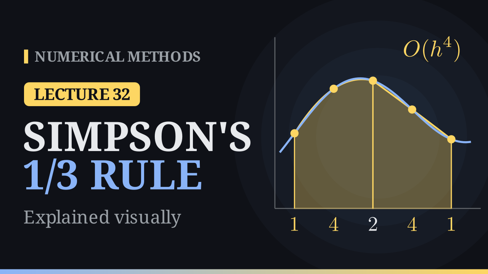

Lecture 32

# Simpson's 1/3 Rule

{ .nm-video }

[Practise this lecture](../practice/lec32_simpson_13.html){ .md-button .md-button--primary }

#### Key results
- **Simpson's 1/3 rule:** \(\int_a^b f(x)\,dx=\frac{h}{3}\big(f_0+4f_1+f_2\big)-\frac{h^5}{90}f^{(4)}(\eta)\), with \(h=\frac{b-a}{2}\). It is **exact for cubics**: degree of precision \(3\).
- It is \(\frac{2M+T}{3}\), the combination of the midpoint and trapezoidal rules that cancels their \(h^2\) errors, and the extrapolated trapezoidal rule \(S_{2n}=\frac{4T_{2n}-T_n}{3}\).
- **Composite rule** (\(n\) even): \(S_n=\frac h3\big(f_0+4f_1+2f_2+4f_3+\dots+2f_{n-2}+4f_{n-1}+f_n\big)\), error \(-\frac{(b-a)h^4}{180}f^{(4)}(\mu)=O(h^4)\): halving \(h\) divides the error by \(16\).
- For \(\int_0^1\frac{dx}{1+x^2}=\frac{\pi}{4}\): \(S_2=0.783333\) (error \(0.0021\)), \(S_4=0.785392\) (error \(6.0\times10^{-6}\)), and \(n=20\) guarantees an error of at most \(10^{-6}\).

## From the trapezoid and the midpoint

On \(I=\int_0^1\frac{dx}{1+x^2}=\frac\pi4\approx0.785398\), one trapezoid gives \(T_1=0.75\) (\(I-T_1=+0.0354\)) and the midpoint rule gives \(M_1=0.8\) (\(I-M_1=-0.0146\)). The two errors have opposite signs and \(I-T\approx-2\,(I-M)\), so the weights \(\frac23\) and \(\frac13\) cancel them:

\[
\frac{2M_1+T_1}{3}=\frac{2(0.8)+0.75}{3}=0.7833 .
\]

Written out with \(M=(b-a)f(m)\) and \(T=\frac{b-a}{2}\big(f(a)+f(b)\big)\), and \(h=\frac{b-a}{2}\),

\[
\frac{2M+T}{3}=\frac{h}{3}\big(f(a)+4f(m)+f(b)\big).
\]

## The rule from a parabola

Take the three equally spaced nodes \(x_0=a\), \(x_1=\frac{a+b}{2}\), \(x_2=b\), with \(h=\frac{b-a}{2}\), and integrate the parabola \(p_2\) through \((x_i,f(x_i))\). The weights are the integrals of the Lagrange basis functions; with \(x=x_0+sh\), \(s\in[0,2]\),

\[
\begin{aligned}
a_0&=\frac h2\int_0^2(s-1)(s-2)\,ds=\frac h3,\\
a_1&=-h\int_0^2 s(s-2)\,ds=\frac{4h}3,\\
a_2&=\frac h2\int_0^2 s(s-1)\,ds=\frac h3 .
\end{aligned}
\]

\[
\boxed{\int_a^b f(x)\,dx\approx\frac{h}{3}\big(f_0+4f_1+f_2\big)=\frac{b-a}{6}\Big(f(a)+4f\big(\tfrac{a+b}{2}\big)+f(b)\Big)}
\]

**Example.** With \(h=0.5\): \(S_2=\frac{0.5}{3}\big(1+4(0.8)+0.5\big)=0.783333\), so \(I-S_2=+0.0021\), seventeen times smaller than the error of one trapezoid.

## The error

Integrating the quadratic-interpolation remainder,

\[
E(f)=\frac{1}{3!}\int_a^b f'''(\xi_x)(x-x_0)(x-x_1)(x-x_2)\,dx=\frac{h^4}{3!}\int_0^2 f'''(\xi_x)\,s(s-1)(s-2)\,ds .
\]

The weight \(s(s-1)(s-2)\) is positive on \((0,1)\) and negative on \((1,2)\), so the Weighted Mean Value Theorem cannot be used. But the two lobes are mirror images and \(\int_0^2 s(s-1)(s-2)\,ds=0\): for a cubic \(f\), \(f'''\) is constant and the error vanishes. **Simpson's rule is exact for cubics.**

On \([0,1]\) the rule integrates \(1,x,x^2,x^3\) exactly (for \(x^3\): \(\frac16\big(0+\frac48+1\big)=\frac14\)), but gives \(\frac{5}{24}\) for \(x^4\) instead of \(\frac15\). The degree of precision is \(3\). The error constant for \(x^4\) is

\[
C=\int_a^b x^4\,dx-\frac{b-a}{6}\Big(a^4+4\big(\tfrac{a+b}{2}\big)^4+b^4\Big)=-\frac{(b-a)^5}{120},
\]

so

\[
\boxed{E(f)=\frac{C}{4!}f^{(4)}(\eta)=-\frac{(b-a)^5}{2880}f^{(4)}(\eta)=-\frac{h^5}{90}f^{(4)}(\eta)}
\]

For \(x^4\) on \([0,1]\): \(-\frac{(1/2)^5}{90}\cdot24=-\frac1{120}=\frac15-\frac5{24}\).

## The composite Simpson rule

Split \([a,b]\) into an **even** number \(n\) of pieces of width \(h=\frac{b-a}{n}\), group them in pairs and put a parabola on each pair. Odd nodes are midpoints (weight \(4\)); even interior nodes are shared by two pairs (weight \(1+1=2\)):

\[
S_n=\frac{h}{3}\Big(f(x_0)+4\sum_{i=1}^{n/2}f(x_{2i-1})+2\sum_{i=1}^{n/2-1}f(x_{2i})+f(x_n)\Big).
\]

Each pair contributes \(-\frac{h^5}{90}f^{(4)}(\eta_i)\); there are \(\frac n2\) pairs and \(nh=b-a\), so

\[
E_S(f)=-\frac{h^5}{90}\sum_{i=1}^{n/2}f^{(4)}(\eta_i)=-\frac{(b-a)\,h^4}{180}\,f^{(4)}(\mu),\qquad \mu\in[a,b].
\]

The error is \(O(h^4)\): halving \(h\) divides it by \(16\), a slope of \(-4\) on a log–log plot (against \(-2\) for the trapezoidal and midpoint rules).

## Worked example: \(n=4\)

With \(h=0.25\):

| \(i\) | 0 | 1 | 2 | 3 | 4 |
|---|---:|---:|---:|---:|---:|
| \(x_i\) | 0 | 0.25 | 0.5 | 0.75 | 1 |
| \(f(x_i)\) | 1 | 0.9412 | 0.8 | 0.64 | 0.5 |
| weight | 1 | 4 | 2 | 4 | 1 |

The weighted sum is \(1+4(0.9412+0.64)+2(0.8)+0.5=9.4247\), so \(S_4=\frac{0.25}{3}\cdot9.4247=0.785392\), with error \(6.0\times10^{-6}\): over \(400\) times smaller than the trapezoidal error \(0.0026\) from the same five values.

As \(n\) doubles:

| \(n\) | 2 | 4 | 8 | 16 | 32 |
|---|---:|---:|---:|---:|---:|
| \(I-T_n\) | 0.0104 | 0.0026 | \(6.5\times10^{-4}\) | \(1.6\times10^{-4}\) | \(4.1\times10^{-5}\) |
| \(I-S_n\) | 0.0021 | \(6.0\times10^{-6}\) | \(3.8\times10^{-8}\) | \(5.9\times10^{-10}\) | \(9.2\times10^{-12}\) |

The Simpson errors fall by \(344\), \(159\), \(64\), \(64\): even faster than \(16\). The leading term of the error is \(-\frac{h^4}{180}\big(f'''(b)-f'''(a)\big)\), and for this integrand \(f'''(0)=f'''(1)=0\). The order \(h^4\) is a guarantee, not always the exact rate; for a typical integrand such as \(e^x\) on \([0,1]\) every doubling divides the error by \(16\).

## The Richardson view

Since \(I\approx T_n+c\,h^2\) and \(I\approx T_{2n}+c\,\frac{h^2}{4}\), eliminating \(c\) gives

\[
S_{2n}=\frac{4T_{2n}-T_n}{3}:
\]

the straight line through the trapezoidal values plotted against \(h^2\), extended to \(h=0\). For example \(\frac{4(0.775)-0.75}{3}=0.783333=S_2\) and \(\frac{4(0.782794)-0.775}{3}=0.785392=S_4\).

## Choosing \(n\)

On \([0,1]\), \(\max|f^{(4)}|=24\) (at \(x=0\)), so \(|E_S|\le\frac{h^4}{180}\cdot24=\frac{2h^4}{15}\). For an error of at most \(10^{-6}\) we need \(h\le0.0523\), i.e. \(n\ge19.1\); \(n\) must be even, so \(n=20\). The trapezoidal rule needed \(n=409\), the midpoint rule \(289\).

## Weak cases

- **\(n\) must be even.** Data at six equally spaced points gives five pieces: two pairs and one piece left over. A trapezoid on the last piece spoils the order; the proper fix treats three pieces with a cubic (Simpson's \(3/8\) rule, next lecture).
- **Non-smooth \(f\).** For \(\int_0^1\sqrt x\,dx=\frac23\), \(f^{(4)}\) blows up at \(0\). The errors \(0.0101,\ 0.0036,\ 0.0013,\ 0.00045\) for \(n=4,8,16,32\) fall by only about \(2.8\) per doubling, the same rate as the trapezoidal rule. High order pays off only for smooth functions.

## Algorithm (composite Simpson rule)

1. \(h=(b-a)/n\), with \(n\) even.
2. \(\text{sum}=f(a)+f(b)\), \(p=4\).
3. For \(i=1,\dots,n-1\): add \(p\,f(a+ih)\) to the sum, then \(p=6-p\) (weights \(4,2,4,2,\dots\)).
4. Return \(\frac h3\cdot\text{sum}\).

It uses \(n+1\) function values, the same as the trapezoidal rule.

| | midpoint | trapezoid | Simpson |
|---|:---:|:---:|:---:|
| precision | 1 | 1 | 3 |
| error, one panel | \(+\frac{h^3}{24}f''\) | \(-\frac{h^3}{12}f''\) | \(-\frac{h^5}{90}f^{(4)}\) |
| composite error | \(O(h^2)\) | \(O(h^2)\) | \(O(h^4)\) |
| error with \(n=4\) | \(-1.3\times10^{-3}\) | \(+2.6\times10^{-3}\) | \(+6.0\times10^{-6}\) |
| \(n\) for \(10^{-6}\) | 289 | 409 | 20 |

Next lecture: Simpson's \(3/8\) rule, \(\frac{3h}{8}\big(f_0+3f_1+3f_2+f_3\big)\), a cubic through four points, for an odd number of pieces.

[Practise this lecture](../practice/lec32_simpson_13.html){ .md-button .md-button--primary }
[← Previous: The Trapezoidal Rule](lec31-trapezoidal.md){ .md-button }
[Next: Simpson's 3/8 Rule →](lec33-simpson-38.md){ .md-button }

