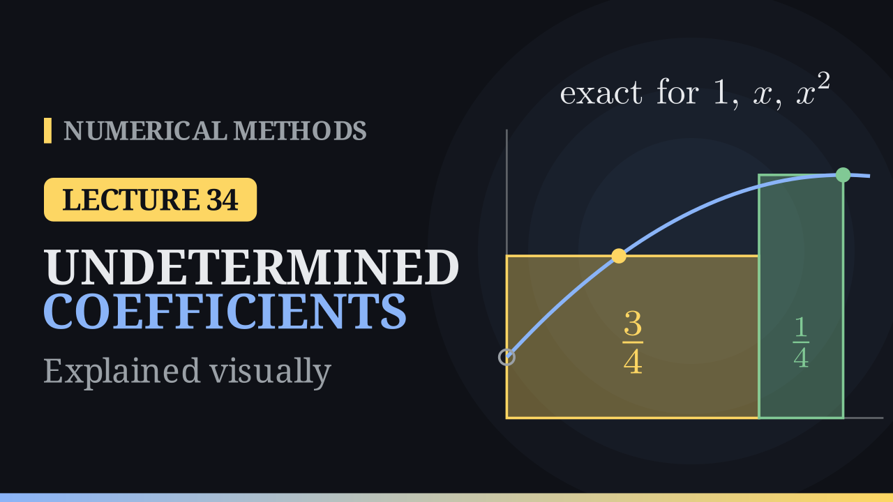

Lecture 34

# Method of Undetermined Coefficients

{ .nm-video }

[Practise this lecture](../practice/lec34_undetermined_coefficients.html){ .md-button .md-button--primary }

#### Key results
- **The method:** write the rule as \(\int_a^b f(x)\,dx\approx\sum_{i=0}^n\lambda_if(x_i)\) and demand exactness for \(1,x,\dots,x^n\): \(\sum_i\lambda_ix_i^k=\frac{b^{k+1}-a^{k+1}}{k+1}\). The matrix is the transposed Vandermonde matrix, so for distinct nodes the weights are unique.
- **Degree of precision \(p\):** exact for every polynomial of degree \(\le p\), not for some polynomial of degree \(p+1\).
- **Error constant:** \(C=\int_a^b x^{p+1}\,dx-\sum_i\lambda_ix_i^{p+1}\) and \(E(f)=\frac{C}{(p+1)!}f^{(p+1)}(\eta)\).
- **Classics recovered:** trapezoid (\(C=-\frac{h^3}{6}\), \(E=-\frac{h^3}{12}f''\)), Simpson \(1/3\) (\(E=-\frac{h^5}{90}f^{(4)}\)), Simpson \(3/8\) (\(C=-\frac{9h^5}{10}\), \(E=-\frac{3h^5}{80}f^{(4)}\)).
- **New nodes:** \(\int_0^hf\,dx\approx\frac{3h}{4}f\big(\frac h3\big)+\frac h4f(h)\), precision \(2\), \(E=-\frac{h^4}{216}f'''(\eta)\). On \(\int_0^1e^x\,dx\) it gives \(1.726280\) (error \(-8.0\times10^{-3}\)); on \(\frac\pi4\) it gives \(0.8\), less than half the trapezoid's error with the same number of values.
- **Open rule:** one node at the midpoint of \([-h,h]\) gives \(\int_{-h}^hf\,dx=2h\,f(0)+\frac{h^3}{3}f''(\eta)\), precision \(1\): the midpoint rule.
- **Weak cases:** many equally spaced nodes give negative weights (from \(n=8\)), \(\sum|\lambda_i|=544\) for \(n=20\), and an ill-conditioned Vandermonde system.

## Why another road?

The trapezoidal rule \(\frac h2(1,1)\), Simpson's \(1/3\) rule \(\frac h3(1,4,1)\) and the \(3/8\) rule \(\frac{3h}{8}(1,3,3,1)\) all use fixed, equally spaced nodes, and each weight came from integrating a Lagrange basis polynomial, \(\lambda_i=\int_a^b\ell_i(x)\,dx\). The method of undetermined coefficients gets the same weights, and the error, from a small linear system.

## The idea

Write the rule as a weighted sum

\[
\int_a^b f(x)\,dx\approx\lambda_0f(x_0)+\lambda_1f(x_1)+\dots+\lambda_nf(x_n),
\]

with the nodes given and the weights unknown. Feed it \(f=1,x,x^2,\dots\): each exact integral gives one linear equation for the weights. Since the integral and the rule are both linear, a rule that is exact for \(1,x,\dots,x^d\) is exact for every polynomial of degree \(\le d\).

With \(n+1\) weights we impose \(n+1\) conditions; row \(k\) reads

\[
\sum_{i=0}^n\lambda_ix_i^k=\int_a^bx^k\,dx=\frac{b^{k+1}-a^{k+1}}{k+1},\qquad k=0,1,\dots,n.
\]

The matrix is the transpose of the Vandermonde matrix from interpolation; for distinct nodes it is invertible, and the weights exist and are unique.

**Degree of precision.** A rule has degree of precision \(p\) if it integrates every polynomial of degree at most \(p\) exactly, but fails for at least one polynomial of degree \(p+1\). For Simpson's rule on \([-1,1]\), \(\frac13\big(f(-1)+4f(0)+f(1)\big)\), the monomials \(1,x,x^2,x^3\) give \(2,0,\frac23,0\), as the integrals do, but \(x^4\) gives \(\frac23\) instead of \(\frac25\): \(p=3\).

## The error constant

If \(x^{p+1}\) is the first monomial that fails, the gap

\[
C=\int_a^b x^{p+1}\,dx-\sum_i\lambda_ix_i^{p+1}
\]

is the error constant. In the Taylor expansion of \(f\) the part of degree \(\le p\) is integrated exactly, and the next term \(\frac{f^{(p+1)}}{(p+1)!}x^{p+1}\) is integrated with error \(C\). This gives

\[
\boxed{E(f)=\frac{C}{(p+1)!}\,f^{(p+1)}(\eta)}
\]

## The classical rules

**Trapezoid.** Exactness does not change under a shift, so take \([0,h]\) with nodes \(0,h\). \(f=1\): \(\lambda_0+\lambda_1=h\); \(f=x\): \(\lambda_1h=\frac{h^2}{2}\). So \(\lambda_0=\lambda_1=\frac h2\). For \(x^2\): \(\frac{h^3}{3}\) against \(\frac h2h^2=\frac{h^3}{2}\), so \(C=-\frac{h^3}{6}\), \(p=1\) and \(E=-\frac{h^3}{12}f''(\eta)\).

**Simpson's 1/3 rule.** With \(x_0,\ x_1=x_0+h,\ x_2=x_0+2h\) the three conditions reduce to

\[
\lambda_0+\lambda_1+\lambda_2=2h,\qquad \lambda_1+2\lambda_2=2h,\qquad \lambda_1+4\lambda_2=\frac{8h}{3},
\]

so \(\lambda_2=\frac h3\), \(\lambda_1=\frac{4h}{3}\), \(\lambda_0=\frac h3\). On \([-h,h]\) the rule integrates the parabola through the three points of \(x^3\), which is the line \(h^2x\); the gap \(x^3-h^2x\) is odd and its areas cancel, so \(x^3\) is exact too. For \(x^4\): \(\frac{2h^5}{5}\) against \(\frac{2h^5}{3}\), \(C=-\frac{4h^5}{15}\), \(p=3\) and \(E=-\frac{h^5}{90}f^{(4)}(\xi)\).

**Simpson's 3/8 rule.** On \([0,3]\) with \(h=1\):

\[
\begin{aligned}
\lambda_0+\lambda_1+\lambda_2+\lambda_3&=3, & \lambda_1+2\lambda_2+3\lambda_3&=\tfrac92,\\
\lambda_1+4\lambda_2+9\lambda_3&=9, & \lambda_1+8\lambda_2+27\lambda_3&=\tfrac{81}{4},
\end{aligned}
\]

with solution \(\frac38,\frac98,\frac98,\frac38=\frac38(1,3,3,1)\). For \(x^4\): \(\frac{243}{5}-\frac{99}{2}=-\frac{9}{10}\), so \(E=-\frac{9}{10\cdot4!}h^5f^{(4)}=-\frac{3h^5}{80}f^{(4)}(\xi)\).

## A rule on unusual nodes

Choose \(w_0,w_1,w_2\) in

\[
\int_0^hf(x)\,dx\approx h\Big(w_0f(0)+w_1f\big(\tfrac h3\big)+w_2f(h)\Big)
\]

for the highest possible degree. Exactness for \(1,x,x^2\) gives

\[
w_0+w_1+w_2=1,\qquad \frac{w_1}{3}+w_2=\frac12,\qquad \frac{w_1}{9}+w_2=\frac13 .
\]

Subtracting the last two, \(\frac29w_1=\frac16\), so \(w_1=\frac34\), \(w_2=\frac14\) and \(w_0=0\): the value \(f(0)\) is not needed at all,

\[
\int_0^hf(x)\,dx\approx\frac{3h}{4}f\big(\tfrac h3\big)+\frac h4f(h).
\]

Geometrically, the rule is the area of two rectangles of widths \(\frac{3h}{4}\) and \(\frac h4\), and for every parabola it equals the area under the curve. For \(x^3\): \(\frac{h^4}{4}\) against \(\frac{h^4}{36}+\frac{h^4}{4}\), so \(C=-\frac{h^4}{36}\), \(p=2\) and

\[
E(f)=-\frac{h^4}{216}f'''(\eta).
\]

## Worked example

For \(\int_0^1e^x\,dx=e-1\approx1.718282\) with \(h=1\):

| term | value |
|---|---:|
| \(\frac34e^{1/3}\) | 1.046709 |
| \(\frac14e\) | 0.679570 |
| rule | 1.726280 |

The error is \(-8.0\times10^{-3}\). The formula predicts \(-\frac{e^\eta}{216}\), between \(-\frac{e}{216}\approx-0.0126\) and \(-\frac1{216}\approx-0.0046\); the actual error corresponds to \(\eta\approx0.55\).

On \(\int_0^1\frac{dx}{1+x^2}=\frac\pi4\) the rule uses \(f(\frac13)=0.9\) and \(f(1)=0.5\) and gives \(0.8\) (error \(-1.5\times10^{-2}\)); the trapezoidal rule, with two values as well, gives \(0.75\) (error \(3.5\times10^{-2}\)).

**Composite rule.** On \(n\) pieces of width \(h\) the errors add up to \(-\frac{(b-a)h^3}{216}f'''(\mu)=O(h^3)\). For \(\int_0^1e^x\,dx\):

| \(n\) | 1 | 2 | 4 | 8 | 16 |
|---|---:|---:|---:|---:|---:|
| \(I-R_n\) | \(-8.00\times10^{-3}\) | \(-1.00\times10^{-3}\) | \(-1.25\times10^{-4}\) | \(-1.56\times10^{-5}\) | \(-1.95\times10^{-6}\) |
| ratio | | 7.97 | 8.02 | 8.02 | 8.01 |

On a log–log plot the errors lie on a line of slope \(-3\).

## An open rule: the midpoint rule

The nodes need not include the end points. Take a single node in the middle of \([-h,h]\): \(\int_{-h}^hf\,dx\approx\lambda f(0)\). The condition for \(f=1\) gives \(\lambda=2h\). The function \(x\) is odd, so \(\int_{-h}^hx\,dx=0=2h\cdot0\): exact for free. For \(x^2\) the integral is \(\frac{2h^3}{3}\) and the rule gives \(0\), so \(C=\frac{2h^3}{3}\), \(p=1\) and

\[
\int_{-h}^hf(x)\,dx=2h\,f(0)+\frac{h^3}{3}f''(\eta).
\]

This is the midpoint rule (with \(L=2h\) the error is \(\frac{L^3}{24}f''\), as in Lecture 30), an open rule that never uses \(f(a)\) or \(f(b)\).

## Weak cases

- **Negative weights.** On \(n+1\) equally spaced nodes in \([0,1]\) (closed Newton–Cotes), all weights are positive up to \(n=7\); for \(n=8\) the smallest weight is \(-0.16\), and for \(n=10\) the weights range from \(-0.44\) to \(0.71\).
- **Noise amplification.** An error \(\varepsilon\) in the values of \(f\) can change the result by up to \(\varepsilon\sum_i|\lambda_i|\). This sum is \(1\) (the interval length) up to \(n=7\), but \(1.45\) for \(n=8\), \(3.1\) for \(n=10\), \(7.5\) for \(n=12\) and \(544\) for \(n=20\).
- **Ill-conditioning.** The condition number of the Vandermonde matrix grows from about \(15\) (\(n=2\)) to \(1.2\times10^{8}\) (\(n=10\)) and \(8.6\times10^{16}\) (\(n=20\)), beyond double precision. As with Runge's example, high degree on equally spaced nodes is a bad idea.
- With \(k\) unknowns one can impose at most \(k\) conditions, and the error formula needs \(f^{(p+1)}\) to exist and be bounded.

## Algorithm

1. Choose the nodes, shifted to a convenient interval such as \([0,h]\) or \([-h,h]\).
2. Write one equation per monomial: \(\sum_i\lambda_ix_i^k=\int_a^bx^k\,dx\), \(k=0,\dots,n\).
3. Solve the linear system for the weights.
4. Test \(x^{n+1},x^{n+2},\dots\) until a monomial fails: one less than its degree is \(p\), the gap is \(C\), and \(E(f)=\frac{C}{(p+1)!}f^{(p+1)}(\eta)\).

## Two roads to the same rule

| | Lagrange route | undetermined coefficients |
|---|---|---|
| weights | \(\lambda_i=\int_a^b\ell_i(x)\,dx\), one at a time | one linear system |
| error | separate argument | from the next monomial |
| nodes | any distinct nodes | any distinct nodes |
| unknown nodes | no | yes |

Both give the same unique weights. Next lecture: Gauss–Legendre quadrature, where the nodes are unknowns too; the two nodes \(\pm\frac1{\sqrt3}\) give \(\int_{-1}^1f\,dx\approx f\big(-\frac1{\sqrt3}\big)+f\big(\frac1{\sqrt3}\big)\), exact for every cubic.

[Practise this lecture](../practice/lec34_undetermined_coefficients.html){ .md-button .md-button--primary }
[← Previous: Simpson's 3/8 Rule](lec33-simpson-38.md){ .md-button }
[Next: Gauss–Legendre Quadrature →](lec35-gauss-legendre.md){ .md-button }

