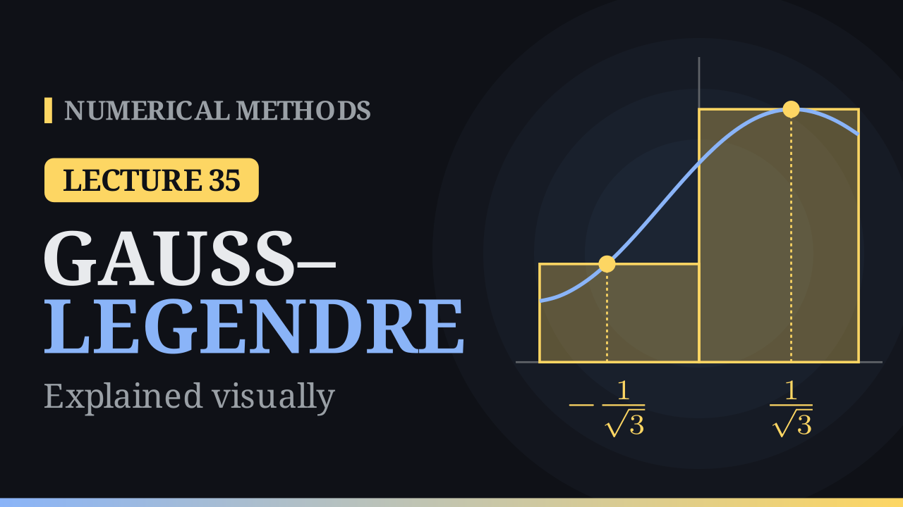

Lecture 35

# Gauss–Legendre Quadrature

{ .nm-video }

[Practise this lecture](../practice/lec35_gauss_legendre.html){ .md-button .md-button--primary }

#### Key results
- **Free nodes.** With \(n\) nodes and \(n\) weights all free there are \(2n\) unknowns, so the rule \(\int_{-1}^1f\,dx\approx\sum_i\lambda_if(x_i)\) can be exact for \(1,x,\dots,x^{2n-1}\): degree of precision \(2n-1\), the highest possible for \(n\) points.
- **Two points:** \(\int_{-1}^1f\,dx\approx f\big(-\frac{1}{\sqrt3}\big)+f\big(\frac{1}{\sqrt3}\big)\), error \(\frac{1}{135}f^{(4)}(\eta)\). **Three points:** \(\frac59f\big(-\sqrt{\frac35}\big)+\frac89f(0)+\frac59f\big(\sqrt{\frac35}\big)\), error \(\frac{1}{15750}f^{(6)}(\eta)\).
- **Interval of length \(L\):** two-point error \(\frac{L^5}{4320}f^{(4)}\) against \(\frac{L^5}{2880}f^{(4)}\) for Simpson; three-point error \(\frac{L^7}{2016000}f^{(6)}\).
- **Nodes** are the roots of the Legendre polynomial \(P_n\); the weights are positive and add up to \(2\).
- **Any interval:** \(x=\frac{b-a}{2}t+\frac{a+b}{2}\) gives \(\int_a^bf\,dx\approx\frac{b-a}{2}\sum_i\lambda_if(x_i)\).
- For \(\int_0^1\frac{dx}{1+x^2}=\frac{\pi}{4}\): two points give \(0.786885\) (error \(1.5\times10^{-3}\)), three points \(0.785267\) (error \(1.3\times10^{-4}\)); for \(\int_0^3e^x\,dx=19.0855\): \(18.8101\) and \(19.0803\).

## Free nodes

A Newton–Cotes rule fixes the nodes and finds the weights from a linear system; with \(n\) nodes it reaches degree of precision \(n-1\), or \(n\) when the number of nodes is odd. In a Gauss–Legendre rule the nodes \(x_i\) are unknowns too. With \(n\) nodes and \(n\) weights we may impose \(2n\) conditions, exactness for \(1,x,\dots,x^{2n-1}\). We work on \([-1,1]\) and move to a general interval at the end.

## The one-point rule

For \(\int_{-1}^1f\,dx\approx\lambda_0f(x_0)\): \(f=1\) gives \(\lambda_0=2\), and \(f=x\) gives \(0=\lambda_0x_0\), so \(x_0=0\). The result \(2f(0)\) is the midpoint rule. Graphically, a rectangle of width \(2\) has the same area as the region under a straight line only when its height is taken in the middle.

## The two-point rule

For \(\int_{-1}^1f\,dx\approx\lambda_0f(x_0)+\lambda_1f(x_1)\), exactness for \(1,x,x^2,x^3\) gives

\[
\begin{aligned}
\lambda_0+\lambda_1&=2, &(1)\\
\lambda_0x_0+\lambda_1x_1&=0, &(2)\\
\lambda_0x_0^2+\lambda_1x_1^2&=\tfrac23, &(3)\\
\lambda_0x_0^3+\lambda_1x_1^3&=0. &(4)
\end{aligned}
\]

The unknowns multiply each other: the system is nonlinear. Subtracting \(x_0^2\) times (2) from (4) gives \(\lambda_1x_1(x_1^2-x_0^2)=0\). In a genuine two-point rule \(\lambda_1x_1\neq0\) and \(x_1\neq x_0\), so \(x_1=-x_0\). Then (2) gives \(\lambda_0=\lambda_1\), (1) gives \(\lambda_0=\lambda_1=1\), and (3) gives \(x_0^2=\frac13\):

\[
\boxed{\int_{-1}^{1}f(x)\,dx\approx f\Big(-\frac{1}{\sqrt3}\Big)+f\Big(\frac{1}{\sqrt3}\Big)}
\]

**As a picture.** With nodes \(\pm c\) and weights \(1\), the rule is the area of two bars of width \(1\) at heights \(f(\pm c)\). Odd functions are exact by symmetry. For \(x^2\) the bars have area \(2c^2\) and the curve \(\frac23\); they match at \(c=\frac{1}{\sqrt3}\approx0.5774\). Equivalently, \(x^2-\frac13\) has zero integral, and the nodes are exactly where it crosses zero.

**Error.** For \(x^4\) the integral is \(\frac25\) but the rule gives \(\frac29\), so the degree of precision is \(3\), the error constant is \(C=\frac25-\frac29=\frac{8}{45}\), and

\[
E(f)=\frac{C}{4!}f^{(4)}(\eta)=\frac{1}{135}f^{(4)}(\eta),\qquad\eta\in[-1,1].
\]

Two function values give the precision of Simpson's rule, which needs three.

## The three-point rule

Six unknowns allow exactness up to \(x^5\). With the symmetric guess \(A\,f(-c)+B\,f(0)+A\,f(c)\) the odd powers are exact automatically, and

\[
2A+B=2,\qquad 2Ac^2=\tfrac23,\qquad 2Ac^4=\tfrac25
\]

give \(c^2=\frac35\), \(A=\frac59\), \(B=\frac89\):

\[
\boxed{\int_{-1}^{1}f(x)\,dx\approx\frac59f\Big(-\sqrt{\tfrac35}\Big)+\frac89f(0)+\frac59f\Big(\sqrt{\tfrac35}\Big)}
\]

with degree of precision \(5\). From \(C=\frac27-\frac{10}{9}\big(\frac35\big)^3=\frac{8}{175}\), the error is \(\frac{C}{6!}f^{(6)}(\eta)=\frac{1}{15750}f^{(6)}(\eta)\).

## Legendre polynomials

The Legendre polynomials

\[
P_0=1,\quad P_1=x,\quad P_2=\tfrac12(3x^2-1),\quad P_3=\tfrac12(5x^3-3x),\qquad P_{k+1}=\frac{(2k+1)xP_k-kP_{k-1}}{k+1},
\]

are orthogonal on \([-1,1]\): \(\int_{-1}^1P_jP_k\,dx=0\) for \(j\neq k\). The nodes of the \(n\)-point rule are the roots of \(P_n\): \(0\); \(\pm\frac{1}{\sqrt3}\); \(0,\ \pm\sqrt{\frac35}\).

**Why the roots work.** Divide a cubic \(p\) by \(P_2\): \(p=q\,P_2+r\) with \(q\) and \(r\) linear. By orthogonality \(\int_{-1}^1qP_2\,dx=0\), and the rule also gives \(0\) for \(qP_2\), because \(P_2\) vanishes at both nodes. So the integral and the rule both reduce to those of \(r\), and a linear \(r\) is integrated exactly. Example: \(p=2x^3+x^2-x+1=\frac{4x+2}{3}P_2+\frac{4-x}{3}\); the integral, the integral of \(r\) and the rule all equal \(\frac83\).

**Why \(2n-1\) is the best.** The polynomial \(q(x)=\prod_i(x-x_i)^2\) has degree \(2n\) and \(q\ge0\), so \(\int_{-1}^1q\,dx>0\), but the rule gives \(0\). For two points, \(\int_{-1}^1\big(x^2-\frac13\big)^2dx=\frac{8}{45}\) while the rule gives \(0\).

| \(n\) | nodes \(t_i\) | weights \(\lambda_i\) | precision |
|:-:|:-:|:-:|:-:|
| 1 | \(0\) | \(2\) | 1 |
| 2 | \(\pm0.5774\) | \(1\) | 3 |
| 3 | \(0,\ \pm0.7746\) | \(\frac89,\ \frac59\) | 5 |
| 4 | \(\pm0.3400,\ \pm0.8611\) | \(0.6521,\ 0.3479\) | 7 |
| 5 | \(0,\ \pm0.5385,\ \pm0.9062\) | \(0.5689,\ 0.4786,\ 0.2369\) | 9 |

The nodes are symmetric, crowd towards the ends and never use an end point; the weights are positive and add up to \(2\).

## Change of interval

The map \(x=\frac{b-a}{2}t+\frac{a+b}{2}\) takes \(t\in[-1,1]\) to \(x\in[a,b]\), and \(dx=\frac{b-a}{2}\,dt\):

\[
\int_a^bf(x)\,dx=\frac{b-a}{2}\int_{-1}^1f\Big(\frac{b-a}{2}t+\frac{a+b}{2}\Big)dt\approx\frac{b-a}{2}\sum_i\lambda_if(x_i).
\]

Do not forget the factor \(\frac{b-a}{2}\).

**Error terms on \([a,b]\).** Each derivative with respect to \(t\) brings a factor \(\frac{b-a}{2}\). On an interval of length \(L=b-a\) the error terms become

\[
E_2=\frac{1}{135}\Big(\frac L2\Big)^5f^{(4)}(\eta)=\frac{L^5}{4320}f^{(4)}(\eta),\qquad E_3=\frac{1}{15750}\Big(\frac L2\Big)^7f^{(6)}(\eta)=\frac{L^7}{2016000}f^{(6)}(\eta).
\]

Simpson's rule on the same interval has error \(\frac{L^5}{2880}f^{(4)}\): two Gauss points are \(\frac{4320}{2880}=1.5\) times more accurate than three Simpson points.

## Worked examples

**\(I=\int_0^1\frac{dx}{1+x^2}=\frac{\pi}{4}\approx0.785398\).** The factor is \(\frac12\) and \(x_i=\frac12+\frac12t_i\).

| rule | \(x_i\) | \(f(x_i)\) | result | error |
|---|:-:|:-:|:-:|:-:|
| 2 points | \(0.2113,\ 0.7887\) | \(0.9573,\ 0.6165\) | \(0.786885\) | \(1.5\times10^{-3}\) |
| 3 points | \(0.1127,\ 0.5,\ 0.8873\) | \(0.9875,\ 0.8,\ 0.5595\) | \(0.785267\) | \(1.3\times10^{-4}\) |

With the same two function values the trapezoidal rule (\(0.75\)) has an error \(24\) times larger; with three values Simpson's rule (\(0.783333\)) has an error \(16\) times larger. All rules of this module on this integral, with one interval:

| rule | \(f\) values | approximation | error |
|---|:-:|:-:|:-:|
| rectangle | 1 | 1.000000 | \(2.1\times10^{-1}\) |
| midpoint | 1 | 0.800000 | \(1.5\times10^{-2}\) |
| trapezoidal | 2 | 0.750000 | \(3.5\times10^{-2}\) |
| Gauss–Legendre, 2 points | 2 | 0.786885 | \(1.5\times10^{-3}\) |
| Simpson \(1/3\) | 3 | 0.783333 | \(2.1\times10^{-3}\) |
| Gauss–Legendre, 3 points | 3 | 0.785267 | \(1.3\times10^{-4}\) |
| Simpson \(3/8\) | 4 | 0.784615 | \(7.8\times10^{-4}\) |

**\(\int_0^3e^x\,dx=e^3-1\approx19.0855\).** Here \(x=\frac32t+\frac32\) and the factor is \(\frac32\). The two-point rule gives \(\frac32\big(e^{x_0}+e^{x_1}\big)=18.8101\) (error \(0.275\)) and the three-point rule \(19.0803\) (error \(0.0052\)): about \(50\) times smaller. Simpson's rule with three values gives \(19.5061\) (error \(0.42\)).

**Convergence.** For \(\int_0^1e^x\,dx\) the \(n\)-point Gauss errors are \(7.0\times10^{-2},\ 3.9\times10^{-4},\ 8.2\times10^{-7},\ 9.3\times10^{-10},\ 6.5\times10^{-13}\) for \(n=1,\dots,5\), and six points reach double precision: about three digits per extra point. For a smooth integrand the error falls faster than any power of \(n\).

## Weak cases

- **Non-smooth integrands.** For \(\int_0^1\sqrt x\,dx=\frac23\) the errors for \(n=2,4,8,16\) are \(7.2\times10^{-3},\ 1.2\times10^{-3},\ 1.7\times10^{-4},\ 2.3\times10^{-5}\): doubling \(n\) divides the error by only about \(7\). Since no node is an end point, the rule still works for integrands singular at an end point, only slowly.
- **Irrational nodes.** Tabulated data on a grid cannot be used: the rule needs \(f\) at its own points.
- **No nesting.** Nodes of different rules do not coincide, so increasing \(n\) wastes the earlier function values.
- **The factor** \(\frac{b-a}{2}\) is easily forgotten.

## Algorithm (\(n\)-point Gauss–Legendre rule on \([a,b]\))

1. Take the nodes \(t_i\) and weights \(\lambda_i\) for \(n\) points on \([-1,1]\).
2. Map each node: \(x_i=\frac{b-a}{2}t_i+\frac{a+b}{2}\).
3. Add up \(S=\sum_i\lambda_if(x_i)\).
4. Return \(\frac{b-a}{2}S\).

It uses \(n\) function values. For a long interval, split it into pieces and apply the rule on each (a composite Gauss rule).

## Newton–Cotes vs Gauss–Legendre

| | Newton–Cotes | Gauss–Legendre |
|---|:-:|:-:|
| nodes | equally spaced, end points included | roots of \(P_n\) |
| chosen | weights only | nodes and weights |
| precision with \(n\) points | \(n-1\) or \(n\) | \(2n-1\) |
| tabulated data | yes | no |
| reuse values when refining | yes | no |

For a smooth function that can be evaluated anywhere, Gauss–Legendre is the most accurate for a given number of function values. Next lecture: we leave integration for differential equations. An initial value problem asks for a function \(y\) with \(y'=f(t,y)\) and \(y(t_0)=y_0\).

[Practise this lecture](../practice/lec35_gauss_legendre.html){ .md-button .md-button--primary }
[← Previous: Method of Undetermined Coefficients](lec34-undetermined-coefficients.md){ .md-button }

