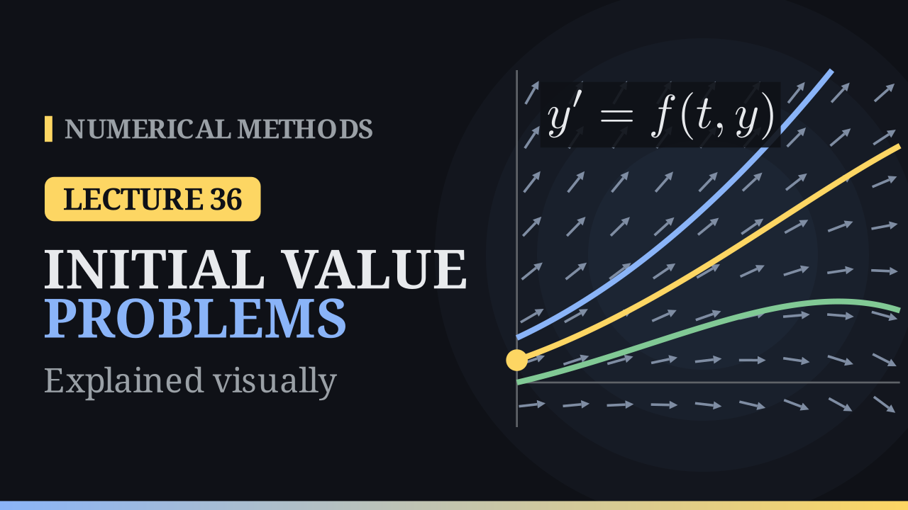

Lecture 36

# Initial Value Problems

{ .nm-video }

[Practise this lecture](../practice/lec36_ode_intro.html){ .md-button .md-button--primary }

#### Key results
- **Initial value problem (IVP):** find \(y(t)\) with \(y'=f(t,y)\) for \(t\ge t_0\) and \(y(t_0)=y_0\). The order of an ODE is its highest derivative.
- **Integration** is the special case \(y'=f(t)\): \(y(b)=y(a)+\int_a^bf(t)\,dt\).
- **Direction field:** every point \((t,y)\) carries the slope \(f(t,y)\); a solution is a curve tangent to the arrows, and the initial value picks one curve.
- **Lipschitz in \(y\):** \(|f(t,y_1)-f(t,y_2)|\le L\,|y_1-y_2|\); a bound \(\big|\frac{\partial f}{\partial y}\big|\le L\) on a convex set gives it. With \(f\) continuous and Lipschitz on a strip, the IVP has exactly one solution and is well-posed.
- **Failures:** \(y'=\sqrt y\), \(y(0)=0\) has infinitely many solutions; \(y'=y^2\), \(y(1)=1\) gives \(y=\frac{1}{2-t}\), which blows up at \(t=2\).
- **Systems:** an equation of order \(m\) becomes \(m\) first-order equations, \(\mathbf Y'=\mathbf F(t,\mathbf Y)\).
- **Numerical solution:** values \(y_j\approx y(t_j)\) at \(t_j=t_0+jh\); the global error is \(|y(t_j)-y_j|\).

## From integrals to differential equations

We can find roots, interpolate, differentiate and integrate. Integration already solves a differential equation: if \(y'=f(t)\) with \(f\) independent of \(y\), then

\[
y(b)=y(a)+\int_a^bf(t)\,dt .
\]

The new problem starts when \(f\) depends on \(y\) too: then the slope depends on the curve we are looking for.

## Ordinary differential equations

An ordinary differential equation (ODE) relates an unknown function \(y(t)\) and its derivatives. The **order** is the highest derivative that appears: \(y'=2t\) has order \(1\), \(y''+y=0\) order \(2\), and \((y')^2-4y=0\) order \(1\) (nonlinear).

**Models.** Growth and decay \(y'=ky\), with \(y=y_0e^{kt}\). Newton's law of cooling \(T'=-k(T-20)\): coffee at \(T(0)=90^\circ\) in a room at \(20^\circ\), with \(k=0.1\) per minute, is at \(20+70e^{-1}\approx45.8^\circ\) after ten minutes. The pendulum \(\theta''=-\frac gL\sin\theta\).

**A family of solutions.** Every \(y=t^2+c\) solves \(y'=2t\): a first-order equation alone has a one-parameter family of solutions. The initial value \(y(0)=1\) picks \(c=1\). This is the **initial value problem**

\[
\boxed{\;\frac{dy}{dt}=f(t,y),\qquad y(t_0)=y_0.\;}
\]

## The direction field

At every point \((t,y)\) the equation gives the slope \(f(t,y)\) of the solution through that point. Drawing a short arrow with this slope at every grid point gives the **direction field** (slope field). For the example of the notes, \(y'=y-t^2+1\): \(f(0,0.5)=1.5\) and \(f(1,2)=2\).

A solution is a curve tangent to the arrows at every point. Here the solutions are \(y=(t+1)^2+Ce^t\) with \(C=y_0-1\):

| \(y(0)\) | solution | \(y(2)\) |
|:-:|:-:|:-:|
| \(0\) | \((t+1)^2-e^t\) | \(1.61\) |
| \(0.5\) | \((t+1)^2-\frac12e^t\) | \(5.3055\) |
| \(1\) | \((t+1)^2\) | \(9\) |

The curves never cross: through every point passes exactly one, so the initial value picks exactly one curve. Two starting values that differ by \(\delta\) stay apart by \(\delta e^t\): the curves spread apart.

## None, many or exactly one?

- \(|y'|+|y|+1=0\) has **no solution**, since the left-hand side is at least \(1\).
- \((y')^2=4y\) is solved by every \(y=(t+c)^2\), and also by \(y\equiv0\), which is not in that family.
- \(y'=\sqrt y\), \(y(0)=0\) has **infinitely many** solutions: \(y\equiv0\), \(y=\frac{t^2}{4}\), and every curve that stays at \(0\) until \(t=a\) and then follows \(\frac{(t-a)^2}{4}\).
- \(y'=y^2\), \(y(1)=1\): separating variables gives \(-\frac1y=t+C\), \(C=-2\), so \(y=\frac{1}{2-t}\). The solution is unique but **blows up** at \(t=2\) (\(y(1.9)=10\)), although \(f\) is smooth.

## Existence, uniqueness and the Lipschitz condition

**Lipschitz condition.** \(f\) is Lipschitz in \(y\) on \(S\) with constant \(L\) if

\[
|f(t,y_1)-f(t,y_2)|\le L\,|y_1-y_2|\qquad\text{for all }(t,y_1),(t,y_2)\in S .
\]

On every vertical line the slope changes at most \(L\) times the distance. If \(\big|\frac{\partial f}{\partial y}\big|\le L\) on a convex set, the mean value theorem gives the condition with the same \(L\). For \(\sqrt y\), \(\frac{\partial f}{\partial y}=\frac{1}{2\sqrt y}\) is unbounded near \(0\); for \(y^2\), \(\frac{\partial f}{\partial y}=2y\) is unbounded on any strip.

**Theorems.**

- *Local existence.* If \(f\) is continuous on \(D=\{|t-t_0|\le a,\ |y-y_0|\le b\}\) and \(M=\max_D|f|\), a solution exists for \(|t-t_0|\le\min(a,b/M)\). Graphically, the solution cannot climb faster than \(M\), so it stays in the cone with slopes \(\pm M\).
- *Local uniqueness.* If \(\frac{\partial f}{\partial y}\) is continuous on \(D\) as well, the solution is unique.
- *Global.* If \(f\) is continuous and Lipschitz in \(y\) on the strip \(t_a\le t\le t_b\), \(y\in\mathbb R\), then for any \(t_0\in[t_a,t_b]\) and \(y_0\) the IVP has exactly one solution, on all of \([t_a,t_b]\).

**Well-posedness.** An IVP is well-posed if a solution exists, is unique, and depends continuously on the data. Under the Lipschitz condition, if \(z'=f(t,z)+\delta(t)\), \(z(t_0)=y_0+\varepsilon_0\) with \(|\varepsilon_0|,|\delta(t)|<\varepsilon\), then

\[
|z(t)-y(t)|\le\varepsilon\Big[e^{L(t-t_0)}+\frac{e^{L(t-t_0)}-1}{L}\Big].
\]

## Worked examples

**Well-posed.** \(y'=y-t^2+1\), \(0\le t\le2\), \(y(0)=0.5\). \(f\) is continuous and \(\frac{\partial f}{\partial y}=1\), so \(|f(t,y_1)-f(t,y_2)|=|y_1-y_2|\): \(L=1\) and the problem is well-posed. The solution is \(y=(t+1)^2-\frac12e^t\), with \(y(2)=5.3055\). Starting from \(0.6\) instead, the gap at \(t=2\) is \(0.1e^2=0.739\).

**Blow-up.** \(y'=y^2\), \(y(1)=1\). Both \(f\) and \(\frac{\partial f}{\partial y}=2y\) are continuous, so the local theorems give a unique solution near \(t=1\). It is \(y=\frac{1}{2-t}\), on \((-\infty,2)\) only. This does not contradict the global theorem: \(2|y|\) is unbounded on every strip, so \(y^2\) is only locally Lipschitz.

## Why numerical methods

Most IVPs have no formula: \(y'=t^2+y^2\), \(\theta''=-\sin\theta\) and even \(y'=e^{-t^2}\) have no elementary solutions. The curve still exists: for \(y'=t^2+y^2\), \(y(0)=0\), it passes \(y(1)=0.3502\) and blows up near \(t\approx2.003\).

## Higher-order equations as systems

With \(y_1=\theta\) and \(y_2=\theta'\), the pendulum becomes

\[
y_1'=y_2,\qquad y_2'=-\frac gL\sin y_1,
\]

or \(\mathbf Y'=\mathbf F(t,\mathbf Y)\), \(\mathbf Y(t_0)=\mathbf Y_0\). An equation of order \(m\) gives \(m\) first-order equations, and every method of this module applies component by component. In the **phase plane** (\(\theta\) against \(\theta'\)) small swings are closed loops; with \(\frac gL=1\), a swing from \(\theta(0)=1\) has period \(6.70\), longer than \(2\pi\approx6.28\) for tiny swings. Beyond the separatrix the pendulum goes over the top.

## What a numerical method produces

Choose a step \(h\) and grid points \(t_j=t_0+jh\), \(j=0,1,\dots,N\). A method produces numbers \(y_j\approx y(t_j)\), not a formula. The **global error** is \(|y(t_j)-y_j|\). For \(y'=y-t^2+1\), \(y(0)=0.5\), \(h=0.5\), the method of the next lecture gives:

| \(j\) | \(t_j\) | \(y_j\) | \(y(t_j)\) | \(\lvert y(t_j)-y_j\rvert\) |
|:-:|:-:|:-:|:-:|:-:|
| 0 | 0 | 0.5 | 0.5000 | 0 |
| 1 | 0.5 | 1.25 | 1.4256 | 0.1756 |
| 2 | 1 | 2.25 | 2.6409 | 0.3909 |
| 3 | 1.5 | 3.375 | 4.0092 | 0.6342 |
| 4 | 2 | 4.4375 | 5.3055 | 0.8680 |

With \(h=0.25\) the error at \(t=2\) is \(0.53\), with \(h=0.125\) it is \(0.295\). Each step lands on a neighbouring solution curve and then follows its field; since the curves spread like \(e^t\), early errors are amplified, and well-posedness keeps them bounded.

**Check the theory first.** A numerical method cannot detect non-uniqueness or blow-up by itself: on \(y'=y^2\), \(y(1)=1\) it marches past \(t=2\) with finite, meaningless numbers, and on \(y'=\sqrt y\), \(y(0)=0\) it stays at \(0\).

## Integration vs initial value problems

| | integration \(y'=f(t)\) | IVP \(y'=f(t,y)\) |
|---|:-:|:-:|
| slope depends on | \(t\) only | \(t\) and \(y\) |
| pieces | independent | each step uses the last |
| errors | simply add up | feed forward |
| nodes | anywhere in \([a,b]\) | march forward from \(t_0\) |

Next lecture: Euler's method. Follow the tangent for one small step, then repeat.

[Practise this lecture](../practice/lec36_ode_intro.html){ .md-button .md-button--primary }
[← Previous: Gauss–Legendre Quadrature](lec35-gauss-legendre.md){ .md-button }
[Next: Euler's Method →](lec37-euler.md){ .md-button }

