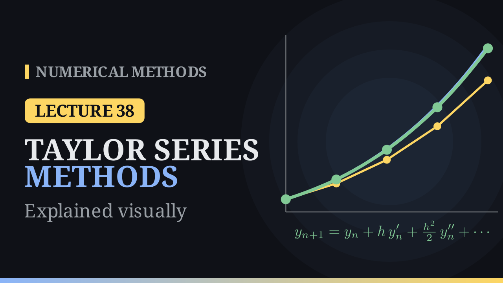

Lecture 38

# Taylor Series Methods

{ .nm-video }

[Practise this lecture](../practice/lec38_taylor_methods.html){ .md-button .md-button--primary }

#### Key results
- **Taylor method of order \(n\)** for \(y'=f(t,y)\): \(y_{j+1}=y_j+h\,y_j'+\frac{h^2}{2!}y_j''+\cdots+\frac{h^n}{n!}y_j^{(n)}\). Euler's method is the Taylor method of order \(1\).
- **Higher derivatives** come from differentiating the equation along the solution: \(y''=f_t+f_y\,f\), and so on.
- **Errors:** the local truncation error is \(\frac{h^{n+1}}{(n+1)!}y^{(n+1)}(\eta)=O(h^{n+1})\), the global error is \(O(h^n)\). A method of order \(p\) has local error \(O(h^{p+1})\) and global error \(O(h^p)\).
- For \(y'=t+y\), \(y(0)=1\), \(h=0.1\): Taylor-2 gives \(y_{10}=3.42816\) against \(y(1)=3.43656\), error \(0.0084\), about \(30\) times smaller than Euler's \(0.249\).
- For an error below \(10^{-6}\) at \(t=1\): Euler needs about \(2.7\) million steps, order \(2\) needs \(952\), order \(3\) needs \(61\), order \(4\) needs \(15\).
- For \(y'=-2ty^2\), \(y(0)=1\), \(h=0.2\): \(y(0.6)\approx0.72485\) against \(\frac{1}{1.36}=0.73529\).
- **Price:** the derivatives of \(f\) must be worked out by hand and grow quickly. On \(y'=\lambda y\) Taylor-2 multiplies by \(1+h\lambda+\frac{(h\lambda)^2}{2}\), stable for \(-2\le h\lambda\le0\).

## The idea

Euler's method follows the tangent line for each step: the Taylor polynomial of degree one. Its error is the curvature it ignores. A Taylor method keeps more terms of the Taylor series of the solution, so each step follows a polynomial that bends the way the solution bends: a parabola for order \(2\), a cubic for order \(3\). For \(y'=t+y\), \(y(0)=1\) the polynomials at \(t=0\) are \(1+t\), \(1+t+t^2\) and \(1+t+t^2+\frac{t^3}{3}\), and each one stays on the exact solution \(y=2e^t-t-1\) longer than the one before. The method walks one step \(h\) along the polynomial and then builds a fresh one at the new point.

## The Taylor method of order n

Expanding the exact solution about \(t_j\),

\[
y(t_j+h)=y(t_j)+h\,y'(t_j)+\frac{h^2}{2!}y''(t_j)+\cdots+\frac{h^n}{n!}y^{(n)}(t_j)+\frac{h^{n+1}}{(n+1)!}y^{(n+1)}(\eta),
\]

with \(\eta\in(t_j,t_j+h)\). Keeping the terms through \(h^n\) gives

\[
\boxed{y_{j+1}=y_j+h\,y_j'+\frac{h^2}{2}\,y_j''+\cdots+\frac{h^n}{n!}\,y_j^{(n)},\qquad t_{j+1}=t_j+h.}
\]

The dropped term is the **local truncation error**, \(O(h^{n+1})\). A method has **order \(p\)** when its local error is \(O(h^{p+1})\); over \(N=\frac{T-t_0}{h}\) steps these errors add up to a global error \(O(h^p)\). So halving \(h\) divides the error of order \(1\), \(2\), \(4\) methods by \(2\), \(4\), \(16\).

## The derivatives

The equation gives only \(y'=f(t,y)\). Along the solution both \(t\) and \(y\) change, so by the chain rule

\[
y''=\frac{d}{dt}f\big(t,y(t)\big)=\frac{\partial f}{\partial t}+\frac{\partial f}{\partial y}\,y'=f_t+f_y\,f,
\]

the total derivative of \(f\). Geometrically: a small step \(dt\) along the solution moves \(t\) by \(dt\) and \(y\) by \(dy=f\,dt\), so \(df=f_t\,dt+f_y\,f\,dt\). Differentiating again gives \(y'''=f_{tt}+2f\,f_{ty}+f^2f_{yy}+f_y\big(f_t+f\,f_y\big)\), and every further derivative has more terms.

**Example from the notes.** For \(y'=-2ty\), \(y(0)=1\): \(y''=-2(y+ty')=-2y+4t^2y\), so

\[
y_{j+1}=y_j-2h\,t_jy_j+\frac{h^2}{2}\big(-2y_j+4t_j^2y_j\big).
\]

With \(h=0.2\) the first step gives \(y_1=1+0+0.02(-2)=0.96\); the exact solution \(e^{-t^2}\) has \(y(0.2)=0.9608\).

## Worked example

Solve \(y'=t+y\), \(y(0)=1\) with \(h=0.1\) by the second-order Taylor method. Here \(f_t=f_y=1\), so \(y''=1+f\).

- \(f(0,1)=1\), \(y''=2\): \(y_1=1+0.1(1)+\frac{0.01}{2}(2)=1.11\) (exact \(1.11034\); Euler \(1.1\)).
- \(f(0.1,1.11)=1.21\), \(y''=2.21\): \(y_2=1.11+0.121+0.01105=1.24205\).

| \(t_j\) | Euler | Taylor-2 | exact | Taylor-2 error |
|:-:|:-:|:-:|:-:|:-:|
| 0.1 | 1.10000 | 1.11000 | 1.11034 | 0.00034 |
| 0.2 | 1.22000 | 1.24205 | 1.24281 | 0.00076 |
| 0.3 | 1.36200 | 1.39847 | 1.39972 | 0.00125 |
| 0.4 | 1.52820 | 1.58180 | 1.58365 | 0.00185 |
| 0.5 | 1.72102 | 1.79489 | 1.79744 | 0.00255 |
| 0.6 | 1.94312 | 2.04086 | 2.04424 | 0.00338 |
| 0.7 | 2.19743 | 2.32315 | 2.32751 | 0.00436 |
| 0.8 | 2.48718 | 2.64558 | 2.65108 | 0.00550 |
| 0.9 | 2.81590 | 3.01236 | 3.01921 | 0.00684 |
| 1.0 | 3.18748 | 3.42816 | 3.43656 | 0.00840 |

The exact solution is convex. Euler's tangent lies below it, so every Euler step lands too low; the Taylor parabola bends upward like the solution and lands almost on it. At \(t=1\) the errors are \(0.249\) and \(0.0084\): about \(30\) times smaller with the same number of steps.

## Errors and order

**Local error.** One Taylor-2 step from \(y(0)=1\) gives \(1.11\) against \(y(0.1)=1.110342\): \(\tau=0.000342\). The formula \(\frac{h^3}{6}y'''(\eta)\) with \(y'''=2e^t\) puts it between \(0.000333\) and \(0.000368\). With \(h=0.05\), \(\tau=0.0000422\), eight times smaller: \(O(h^3)\).

**Global error at \(t=1\).** For \(y'=t+y\) every derivative from \(y''\) on equals \(1+t+y\), so the order-\(n\) method is \(y_{j+1}=y_j+h f_j+\big(\frac{h^2}{2}+\cdots+\frac{h^n}{n!}\big)(1+f_j)\).

| \(h\) | order 1 (Euler) | order 2 | order 3 | order 4 |
|:-:|:-:|:-:|:-:|:-:|
| 0.1 | 0.24908 | \(8.40\times10^{-3}\) | \(2.09\times10^{-4}\) | \(4.17\times10^{-6}\) |
| 0.05 | 0.12997 | \(2.18\times10^{-3}\) | \(2.72\times10^{-5}\) | \(2.72\times10^{-7}\) |
| 0.025 | 0.06644 | \(5.56\times10^{-4}\) | \(3.47\times10^{-6}\) | \(1.73\times10^{-8}\) |
| 0.0125 | 0.03359 | \(1.40\times10^{-4}\) | \(4.38\times10^{-7}\) | \(1.10\times10^{-9}\) |

Each halving of \(h\) divides the errors by about \(2\), \(4\), \(8\) and \(16\); on a log-log plot the four lines have slopes \(1\), \(2\), \(3\) and \(4\). For an error below \(10^{-6}\) at \(t=1\) Euler needs about \(2.7\) million steps, order \(2\) needs \(952\), order \(3\) needs \(61\) and order \(4\) only \(15\).

## A nonlinear example

For \(y'=-2ty^2\), \(y(0)=1\), \(h=0.2\) (notes): \(y''=-2y^2-4ty\,y'=8t^2y^3-2y^2\).

| \(t_j\) | \(y_j\) | \(y_j'\) | \(y_j''\) | \(y_{j+1}\) |
|:-:|:-:|:-:|:-:|:-:|
| 0 | 1 | 0 | \(-2\) | 0.96 |
| 0.2 | 0.96 | \(-0.36864\) | \(-1.56008\) | 0.85507 |
| 0.4 | 0.85507 | \(-0.58492\) | \(-0.66206\) | 0.72485 |

The exact solution is \(y=\frac{1}{1+t^2}\), so \(y(0.6)=\frac{1}{1.36}=0.73529\) and the error is \(0.01045\). Euler's method with the same step gives \(0.78458\), an error of \(0.0493\): the solution bends downward at first, so the straight Euler steps overshoot from above.

**The price.** For this \(f\) the next derivatives are \(y'''=24ty^3-48t^3y^4\) and \(y''''=24y^3-288t^2y^4+384t^4y^5\). For a general \(f\) the third derivative already needs \(f_{tt}\), \(f_{ty}\), \(f_{yy}\), and for systems every partial derivative becomes a matrix or a tensor. All of it must be worked out before the first step.

## Stability

On \(y'=\lambda y\), \(y''=\lambda^2y\), so the second-order Taylor method gives

\[
y_{j+1}=\Big(1+h\lambda+\frac{(h\lambda)^2}{2}\Big)\,y_j,
\]

the first three terms of \(e^{h\lambda}\). For real \(\lambda<0\) the factor is positive (at least \(\tfrac12\)) and at most \(1\) exactly when \(-2\le h\lambda\le0\): the same interval as Euler. For \(y'=-50y\): \(h=0.03\) gives the factor \(0.625\) (Euler: \(-0.5\)), while \(h=0.05\) gives \(1.625\) and the computed values blow up.

On the oscillator \(y''=-y\) each Taylor-2 step multiplies \(y^2+y'^2\) by \(1+\frac{h^4}{4}\) instead of Euler's \(1+h^2\). With \(h=0.1\), after \(63\) steps the factor is \(1.0016\) against \(1.87\) for Euler: the orbit looks closed.

## Algorithm (Taylor method of order n)

1. Before starting, differentiate \(y'=f(t,y)\) to get formulas for \(y'',\dots,y^{(n)}\).
2. For \(k=0,1,\dots,N-1\): evaluate \(y_k',\dots,y_k^{(n)}\) at \((t_k,y_k)\), set \(y_{k+1}=y_k+\sum_{j=1}^n\frac{h^j}{j!}y_k^{(j)}\) and \(t_{k+1}=t_k+h\).
3. Return \(y_1,\dots,y_N\).

With \(n=1\) this is Euler's method.

## Comparison

Taylor methods reach any order, with a clear error term, and need far fewer steps than Euler for the same accuracy. But the derivatives must be worked out by hand for each new problem, they grow quickly in length, and they need partial derivatives of \(f\), which may be unavailable when \(f\) comes from a measurement or a simulation. Next lecture: second-order Runge–Kutta methods reach the same order as Taylor-2 using only values of \(f\), sampled at two points within each step.

[Practise this lecture](../practice/lec38_taylor_methods.html){ .md-button .md-button--primary }
[← Previous: Euler's Method](lec37-euler.md){ .md-button }
[Next: Runge–Kutta Methods: RK2 →](lec39-rk2.md){ .md-button }

