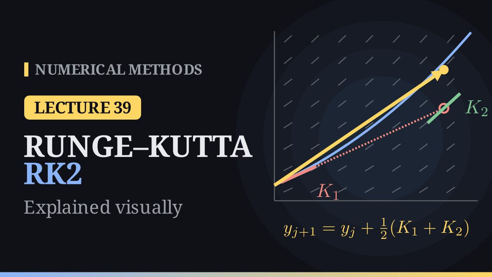

Lecture 39

# Runge–Kutta Methods: RK2

{ .nm-video }

[Practise this lecture](../practice/lec39_rk2.html){ .md-button .md-button--primary }

#### Key results
- **Runge–Kutta idea:** sample the slope at several points inside the step and combine the samples with weights: \(y_{j+1}=y_j+W_1K_1+\dots+W_sK_s\), \(K_i=h\,f\big(t_j+c_ih,\ y_j+\sum_l a_{il}K_l\big)\), with \(c_i=\sum_l a_{il}\).
- **Heun's method:** \(K_1=h\,f(t_j,y_j)\), \(K_2=h\,f(t_j+h,\ y_j+K_1)\), \(y_{j+1}=y_j+\tfrac12(K_1+K_2)\): the trapezoidal rule with Euler's prediction at the right end.
- **Midpoint method:** \(K_2=h\,f\big(t_j+\tfrac h2,\ y_j+\tfrac{K_1}{2}\big)\), \(y_{j+1}=y_j+K_2\).
- **Order conditions:** \(W_1+W_2=1\), \(W_2c_2=\tfrac12\), \(W_2a_{21}=\tfrac12\), so \(c_2=a_{21}=\alpha\), \(W_2=\frac1{2\alpha}\), \(W_1=1-\frac1{2\alpha}\) (Heun \(\alpha=1\), midpoint \(\alpha=\tfrac12\), Ralston \(\alpha=\tfrac23\)). Two stages can never give third order.
- **Errors:** local error \(O(h^3)\), global error \(O(h^2)\): halving \(h\) divides the error by \(4\). Two evaluations of \(f\) per step and no derivatives of \(f\).
- For \(y'=t+y\), \(y(0)=1\), \(h=0.1\): Heun gives \(y(1)\approx3.42816\) (error \(0.0084\)) against Euler's error \(0.249\). For \(y'=t+y^2\), \(y(0)=1\), \(h=0.1\): \(y(0.4)\approx1.77682\) against \(1.78936\).

## The idea

Euler's method reads the slope once, at the start of the step, and follows it. When the solution bends, that slope is wrong for the rest of the step. The second-order Taylor method fixes this by adding \(\frac{h^2}{2}y''\), but \(y''=f_t+f\,f_y\) needs the partial derivatives of \(f\), worked out by hand for every new problem; for \(f=t+y^2\) it is already \(y''=1+2y\,(t+y^2)\).

Runge–Kutta methods reach the same order with values of \(f\) only. Take \(y'=t+y\), \(y(0)=1\) and a large step \(h=0.5\). Euler reads the slope \(f(0,1)=1\) and lands at \(1.5\), well below the exact \(y(0.5)=1.79744\). Reading the field a second time at the point where Euler landed gives the steeper slope \(f(0.5,1.5)=2\). Walking from the start along the average slope \(\frac{1+2}{2}=1.5\) lands at \(1.75\): two looks at the field, one blended step, and the error drops from \(0.297\) to \(0.047\).

## Heun's method and the midpoint method

**Heun's method** turns this into a formula:

\[
K_1=h\,f(t_j,y_j),\qquad K_2=h\,f(t_j+h,\ y_j+K_1),\qquad \boxed{y_{j+1}=y_j+\tfrac12\,(K_1+K_2).}
\]

Euler's step \(y_j+K_1\) is a predictor, the averaged slope a corrector. In integral form, \(y(t_{j+1})=y(t_j)+\int_{t_j}^{t_{j+1}}f\big(t,y(t)\big)\,dt\): Euler uses the left rectangle rule for this integral, Heun the trapezoidal rule \(\frac h2\big[f(t_j,y_j)+f(t_{j+1},y_{j+1})\big]\), with the unknown \(y_{j+1}\) replaced by Euler's prediction.

**The midpoint method** takes half an Euler step and uses the slope found there for the whole step:

\[
K_1=h\,f(t_j,y_j),\qquad K_2=h\,f\big(t_j+\tfrac h2,\ y_j+\tfrac{K_1}{2}\big),\qquad \boxed{y_{j+1}=y_j+K_2.}
\]

This is the midpoint rule of integration. Both rules are exact for straight lines, and both methods are second order.

## The general Runge–Kutta method

An \(s\)-stage Runge–Kutta method reads

\[
y_{j+1}=y_j+W_1K_1+W_2K_2+\dots+W_sK_s,\qquad K_i=h\,f\Big(t_j+c_ih,\ y_j+\sum_{l=1}^{s}a_{il}K_l\Big),
\]

with the row-sum condition \(c_i=\sum_l a_{il}\), so that each stage samples \(f\) at a consistent point. It is **explicit** when \(a_{il}=0\) for \(l\ge i\): each stage uses only earlier stages. The coefficients are often written as a Butcher tableau, with the \(c_i\) on the left, the matrix \(A=(a_{il})\) on the right and the weights \(W_i\) below; Heun's method has \(c=(0,1)\), \(a_{21}=1\), \(W=(\tfrac12,\tfrac12)\), the midpoint method \(c=(0,\tfrac12)\), \(a_{21}=\tfrac12\), \(W=(0,1)\).

## Deriving the second-order methods

A two-stage explicit method,

\[
y_{j+1}=y_j+W_1K_1+W_2K_2,\qquad K_1=h\,f(t_j,y_j),\qquad K_2=h\,f(t_j+c_2h,\ y_j+a_{21}K_1),
\]

has four constants. Expand the exact solution with \(y'=f\), \(y''=f_t+f\,f_y\) and \(y'''=f_{tt}+2f\,f_{ty}+f^2f_{yy}+f_y(f_t+f\,f_y)\), all at \((t_j,y_j)\):

\[
y(t_j+h)=y_j+h\,f+\frac{h^2}{2}\big(f_t+f\,f_y\big)+\frac{h^3}{6}\big(f_{tt}+2f\,f_{ty}+f^2f_{yy}+f_y(f_t+f\,f_y)\big)+O(h^4).
\]

For the method, a two-variable Taylor expansion gives \(K_2=h\big(f+c_2h\,f_t+a_{21}h\,f\,f_y+O(h^2)\big)\), so

\[
y_j+W_1K_1+W_2K_2=y_j+(W_1+W_2)\,h\,f+W_2h^2\big(c_2f_t+a_{21}f\,f_y\big)+O(h^3).
\]

Matching the \(h\) and \(h^2\) terms gives the **order conditions**

\[
W_1+W_2=1,\qquad W_2c_2=\tfrac12,\qquad W_2a_{21}=\tfrac12 .
\]

Three equations for four unknowns leave one free parameter \(\alpha\neq0\): \(c_2=a_{21}=\alpha\), \(W_2=\frac1{2\alpha}\), \(W_1=1-\frac1{2\alpha}\). \(\alpha=1\) gives Heun's method, \(\alpha=\frac12\) the midpoint method and \(\alpha=\frac23\) Ralston's method (\(W_1=\frac14\), \(W_2=\frac34\)). When \(f\) is linear, as in \(y'=t+y\), every member of the family gives the same values, equal to those of the second-order Taylor method.

**No third order.** The \(h^3\) term of the exact solution contains \(\frac16f_y(f_t+f\,f_y)\), a product of first derivatives. The method's \(h^3\) term, \(\frac{W_2}{2}\big(c_2^2f_{tt}+2c_2a_{21}f\,f_{ty}+a_{21}^2f^2f_{yy}\big)\), contains no such products, whatever the constants. So the error of one step is \(O(h^3)\), and over \(\frac1h\) steps the global error is \(O(h^2)\).

## Worked examples

**Example 1.** \(y'=t+y\), \(y(0)=1\), \(h=0.1\), Heun's method; the exact solution is \(y=2e^t-t-1\).

- \(K_1=0.1\,f(0,1)=0.1\), \(K_2=0.1\,f(0.1,\,1.1)=0.12\), so \(y_1=1+\tfrac12(0.1+0.12)=1.11\).
- \(K_1=0.121\), \(K_2=0.1431\), so \(y_2=1.11+\tfrac12(0.121+0.1431)=1.24205\).

| \(t_j\) | Euler | Heun | \(y(t_j)\) |
|:-:|:-:|:-:|:-:|
| 0.1 | 1.10000 | 1.11000 | 1.11034 |
| 0.2 | 1.22000 | 1.24205 | 1.24281 |
| 0.3 | 1.36200 | 1.39847 | 1.39972 |
| 0.4 | 1.52820 | 1.58180 | 1.58365 |
| 0.5 | 1.72102 | 1.79489 | 1.79744 |
| 0.6 | 1.94312 | 2.04086 | 2.04424 |
| 0.7 | 2.19743 | 2.32315 | 2.32751 |
| 0.8 | 2.48718 | 2.64558 | 2.65108 |
| 0.9 | 2.81590 | 3.01236 | 3.01921 |
| 1.0 | 3.18748 | 3.42816 | 3.43656 |

Because \(f\) is linear, the Heun values are exactly the second-order Taylor values. At \(t=1\) the error is \(0.0084\), against \(0.249\) for Euler: two evaluations of \(f\) per step instead of one, and thirty times more accurate.

**Example 2.** \(y'=t+y^2\), \(y(0)=1\), \(h=0.1\), Heun's method up to \(t=0.4\).

| \(j\) | \(t_j\) | \(K_1\) | \(K_2\) | \(y_j\) | reference |
|:-:|:-:|:-:|:-:|:-:|:-:|
| 1 | 0.1 | 0.10000 | 0.13100 | 1.11550 | 1.11649 |
| 2 | 0.2 | 0.13443 | 0.17623 | 1.27083 | 1.27356 |
| 3 | 0.3 | 0.18150 | 0.24093 | 1.48205 | 1.48802 |
| 4 | 0.4 | 0.24965 | 0.33988 | 1.77682 | 1.78936 |

The error at \(t=0.4\) is about \(0.0125\); Euler with the same step gives \(1.62925\) (error \(0.16\)). The midpoint method gives \(1.77275\) and Ralston's method \(1.77410\): all second order, with slightly different error constants. The solution of this equation grows very fast and blows up near \(t\approx0.93\).

## Local and global error

For \(y'=t+y\), one Heun step from \(y(0)=1\) gives \(1.11\) against \(y(0.1)=1.110342\): a local error of \(3.42\times10^{-4}\) (Euler: \(0.01034\)). With \(h=0.05\) it is \(4.22\times10^{-5}\), eight times smaller: the local error is \(O(h^3)\).

| \(h\) | Euler error at \(t=1\) | Heun error at \(t=1\) | Heun error \(/\,h^2\) |
|:-:|:-:|:-:|:-:|
| 0.1 | 0.2491 | \(8.40\times10^{-3}\) | 0.840 |
| 0.05 | 0.1300 | \(2.18\times10^{-3}\) | 0.873 |
| 0.025 | 0.0664 | \(5.56\times10^{-4}\) | 0.889 |
| 0.0125 | 0.0336 | \(1.40\times10^{-4}\) | 0.898 |

Halving \(h\) divides Heun's error by about \(4\); on a log-log plot Euler's errors lie on a line of slope \(1\) and Heun's on a line of slope \(2\). The error is about \(0.9\,h^2\).

**Cost.** Compare methods by the number of evaluations of \(f\), not by the number of steps. With \(20\) evaluations up to \(t=1\), Euler (\(h=0.05\)) has error \(0.130\) and Heun (\(h=0.1\)) \(0.0084\). For an error of \(10^{-6}\), Euler needs about \(2.7\) million steps, Heun about \(950\) steps, or \(1900\) evaluations of \(f\).

## A first look at stability

On \(y'=\lambda y\), one Heun step multiplies \(y\) by

\[
1+h\lambda+\frac{(h\lambda)^2}{2},
\]

the first three terms of \(e^{h\lambda}\). For real \(\lambda<0\) its size is at most \(1\) only for \(-2\le h\lambda\le0\), the same interval as for Euler. On oscillations Heun behaves much better: for \(y''=-y\) each step multiplies \(y^2+y'^2\) by \(1+\frac{h^4}{4}\), so with \(h=0.1\) one turn (\(63\) steps) changes it by a factor \(1.0016\), against \(1.87\) for Euler. Stability regions are the subject of Lecture 41.

## Algorithm (RK2, Heun)

1. Input \(f\), \(t_0\), \(y_0\), the step \(h\) and the number of steps \(N\).
2. For \(k=0,1,\dots,N-1\): compute \(K_1=h\,f(t_k,y_k)\) and \(K_2=h\,f(t_k+h,\ y_k+K_1)\), set \(y_{k+1}=y_k+\tfrac12(K_1+K_2)\) and \(t_{k+1}=t_k+h\).
3. Return \(y_1,\dots,y_N\).

Each step costs two evaluations of \(f\); for a system, \(y\), \(f\), \(K_1\) and \(K_2\) are vectors.

## Comparison

| method | order | evaluations of \(f\) per step | derivatives of \(f\) |
|:-:|:-:|:-:|:-:|
| Euler | 1 | 1 | none |
| Taylor-2 | 2 | 1 | \(f_t\), \(f_y\) by hand |
| RK2 (Heun, midpoint, Ralston) | 2 | 2 | none |

Second-order Runge–Kutta methods keep the simplicity of Euler's method and reach the accuracy of the Taylor method. Next lecture: four stages give the classical fourth-order method, \(y_{j+1}=y_j+\frac16\big(K_1+2K_2+2K_3+K_4\big)\), where halving \(h\) divides the error by \(16\).

[Practise this lecture](../practice/lec39_rk2.html){ .md-button .md-button--primary }
[← Previous: Taylor Series Methods](lec38-taylor-methods.md){ .md-button }

