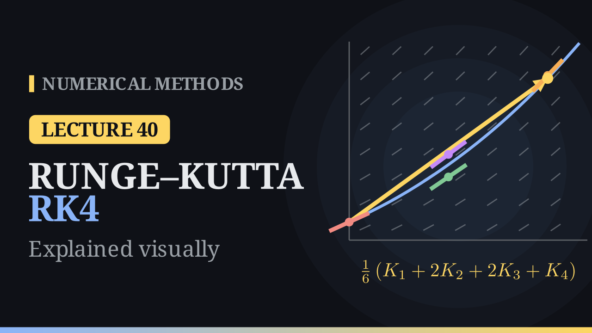

Lecture 40

# Runge–Kutta Methods: RK4

{ .nm-video }

[Practise this lecture](../practice/lec40_rk4.html){ .md-button .md-button--primary }

#### Key results
- **Classical RK4:** \(K_1=h\,f(t_j,y_j)\), \(K_2=h\,f\big(t_j+\tfrac h2,\ y_j+\tfrac{K_1}{2}\big)\), \(K_3=h\,f\big(t_j+\tfrac h2,\ y_j+\tfrac{K_2}{2}\big)\), \(K_4=h\,f(t_j+h,\ y_j+K_3)\), and \(y_{j+1}=y_j+\tfrac16\big(K_1+2K_2+2K_3+K_4\big)\).
- **Four evaluations of \(f\) per step**, no derivatives of \(f\); the method is explicit.
- **Simpson's rule:** when \(f\) depends on \(t\) only, \(K_2=K_3\) and RK4 becomes \(\frac h6\big[f(t_j)+4f(t_j+\frac h2)+f(t_{j+1})\big]\).
- **Errors:** local error \(O(h^5)\), global error \(O(h^4)\): halving \(h\) divides the error by \(16\).
- For \(y'=t+y\), \(y(0)=1\), \(h=0.1\): \(y(1)\approx3.4365595\) against \(3.4365637\), an error of \(4.2\times10^{-6}\) (Heun \(0.0084\), Euler \(0.249\)).
- **Stability:** on \(y'=\lambda y\) one step multiplies \(y\) by \(G(h\lambda)=1+z+\frac{z^2}{2}+\frac{z^3}{6}+\frac{z^4}{24}\), \(z=h\lambda\); for real \(\lambda<0\) it is stable for \(-2.785\le h\lambda\le0\).

## The idea: four looks at the slope

Heun's method reads the slope twice, at the start and at Euler's prediction of the end, and averages. RK4 reads it four times. Take \(y'=t+y\), \(y(0)=1\) and a large step \(h=0.5\):

1. at the start: \(f(0,1)=1\);
2. half a step along that slope, at the middle: \(f(0.25,\,1.25)=1.5\);
3. half a step along the second slope, again at the middle: \(f(0.25,\,1.375)=1.625\);
4. a full step along the third slope, at the end: \(f(0.5,\,1.8125)=2.3125\).

Blending them with the weights \(1,2,2,1\) over \(6\) gives the average slope \(\frac16(1+3+3.25+2.3125)=1.59375\), and the step lands at \(1.796875\). The exact value is \(y(0.5)=1.79744\): the error is \(0.00057\), against \(0.047\) for Heun (\(1.75\)) and \(0.297\) for Euler (\(1.5\)).

## The formulas

\[
\begin{aligned}
K_1&=h\,f(t_j,\ y_j),\\
K_2&=h\,f\big(t_j+\tfrac h2,\ y_j+\tfrac{K_1}{2}\big),\\
K_3&=h\,f\big(t_j+\tfrac h2,\ y_j+\tfrac{K_2}{2}\big),\\
K_4&=h\,f\big(t_j+h,\ y_j+K_3\big),
\end{aligned}
\qquad
\boxed{y_{j+1}=y_j+\tfrac16\big(K_1+2K_2+2K_3+K_4\big).}
\]

Each stage uses only the stages before it, so the method is explicit. Its Butcher tableau has the nodes \(c=(0,\tfrac12,\tfrac12,1)\), the entries \(a_{21}=\tfrac12\), \(a_{32}=\tfrac12\), \(a_{43}=1\) (all others zero) and the weights \(W=(\tfrac16,\tfrac13,\tfrac13,\tfrac16)\).

**Link with Simpson's rule.** If \(f\) depends on \(t\) only, then \(K_2=K_3=h\,f(t_j+\frac h2)\) and

\[
y_{j+1}=y_j+\frac h6\Big[f(t_j)+4f\big(t_j+\tfrac h2\big)+f(t_{j+1})\Big],
\]

which is Simpson's rule on the step. Euler corresponds to the left rectangle rule, Heun to the trapezoidal rule and RK4 to Simpson's rule. For \(y'=\cos t\), \(y(0)=0\), one step with \(h=0.5\) gives \(0.479436\), exactly the Simpson value, against \(\sin0.5=0.479426\).

**Order conditions.** Fourth order requires \(8\) equations for the coefficients. An explicit four-stage method has \(10\) free constants (six \(a_{il}\) and four \(W_i\)), so there is a two-parameter family of fourth-order methods, found by Kutta in 1901. The classical method is the simplest; another member, Kutta's \(\frac38\) rule, has the weights \(\frac18(1,3,3,1)\) and becomes Simpson's \(\frac38\) rule when \(f=f(t)\).

## Worked examples

**Example 1.** \(y'=t+y\), \(y(0)=1\), \(h=0.1\); the exact solution is \(y=2e^t-t-1\).

- \(K_1=0.1\,f(0,1)=0.1\), \(K_2=0.1\,f(0.05,\,1.05)=0.11\), \(K_3=0.1\,f(0.05,\,1.055)=0.1105\), \(K_4=0.1\,f(0.1,\,1.1105)=0.12105\).
- \(y_1=1+\frac16(0.1+0.22+0.221+0.12105)=1.1103417\), against \(y(0.1)=1.1103418\).

| \(t_j\) | Euler | Heun | RK4 | \(y(t_j)\) |
|:-:|:-:|:-:|:-:|:-:|
| 0.1 | 1.10000 | 1.11000 | 1.1103417 | 1.1103418 |
| 0.2 | 1.22000 | 1.24205 | 1.2428051 | 1.2428055 |
| 0.3 | 1.36200 | 1.39847 | 1.3997170 | 1.3997176 |
| 0.4 | 1.52820 | 1.58180 | 1.5836485 | 1.5836494 |
| 0.5 | 1.72102 | 1.79489 | 1.7974413 | 1.7974425 |
| 0.6 | 1.94312 | 2.04086 | 2.0442359 | 2.0442376 |
| 0.7 | 2.19743 | 2.32315 | 2.3275033 | 2.3275054 |
| 0.8 | 2.48718 | 2.64558 | 2.6510791 | 2.6510819 |
| 0.9 | 2.81590 | 3.01236 | 3.0192028 | 3.0192062 |
| 1.0 | 3.18748 | 3.42816 | 3.4365595 | 3.4365637 |

At \(t=1\) the RK4 error is \(4.2\times10^{-6}\), about \(2000\) times smaller than Heun's \(0.0084\).

**Example 2.** \(y'=3t+y^2\), \(y(0)=1\), \(h=0.1\), two steps.

| \(j\) | \(t_j\) | \(K_1\) | \(K_2\) | \(K_3\) | \(K_4\) | \(y_j\) |
|:-:|:-:|:-:|:-:|:-:|:-:|:-:|
| 1 | 0.1 | 0.10000 | 0.12525 | 0.12792 | 0.15722 | 1.12726 |
| 2 | 0.2 | 0.15707 | 0.19039 | 0.19444 | 0.23469 | 1.32083 |

This Riccati equation has no elementary solution; a computation with a tiny step gives \(y(0.2)=1.320829\), so RK4 is off by \(1.5\times10^{-6}\). With the same step Heun gives \(1.31604\) and Euler \(1.251\). The solution blows up near \(t\approx0.84\), so steps must shrink as it gets steep.

## Local and global error

One RK4 step on \(y'=t+y\) from \(y(0)=1\) has the local error \(1.69\times10^{-7}\) for \(h=0.1\) and \(5.25\times10^{-9}\) for \(h=0.05\): \(32=2^5\) times smaller, so the local error is \(O(h^5)\). Over about \(\frac1h\) steps the global error is \(O(h^4)\):

| \(h\) | RK4 error at \(t=1\) | ratio | error \(/\,h^4\) |
|:-:|:-:|:-:|:-:|
| 0.2 | \(6.14\times10^{-5}\) | – | 0.0384 |
| 0.1 | \(4.17\times10^{-6}\) | 14.7 | 0.0417 |
| 0.05 | \(2.72\times10^{-7}\) | 15.3 | 0.0435 |
| 0.025 | \(1.73\times10^{-8}\) | 15.7 | 0.0444 |
| 0.0125 | \(1.10\times10^{-9}\) | 15.8 | 0.0448 |

Each halving divides the error by almost exactly \(16\). On a log-log plot of error against \(h\), Euler, Heun and RK4 give lines of slope \(1\), \(2\) and \(4\): the slope is the order.

**Cost.** With \(40\) evaluations of \(f\) up to \(t=1\), Euler (\(40\) steps) has error \(0.066\), Heun (\(20\) steps) \(0.0022\) and RK4 (\(10\) steps) \(4.2\times10^{-6}\). For an error below \(10^{-6}\), Euler needs about \(2.7\) million evaluations, Heun \(952\) steps (\(1904\) evaluations) and RK4 \(15\) steps (\(60\) evaluations).

**Why order four.** The number of order conditions grows quickly: \(1, 2, 4, 8, 17, 37, 85, 200\) for orders \(1\) to \(8\). Up to order four, \(s\) stages give order \(s\); Butcher showed that order five needs six stages, order six seven and order seven nine. RK4 is the last method that gains one order per evaluation of \(f\).

## Systems and stability

For a system, \(y\), \(f\) and the \(K_i\) are vectors and nothing else changes. On the oscillator \(y''=-y\) (\(y'=v\), \(v'=-y\)) with \(h=0.1\), one turn (\(63\) steps) multiplies the energy \(y^2+v^2\) by \(1.87\) for Euler, \(1.0016\) for Heun and \(0.99999913\) for RK4; even with \(h=0.5\) the RK4 orbit stays almost closed.

On \(y'=\lambda y\), one RK4 step multiplies \(y\) by

\[
G(h\lambda)=1+z+\frac{z^2}{2}+\frac{z^3}{6}+\frac{z^4}{24},\qquad z=h\lambda,
\]

the first five terms of \(e^{z}\). The method is stable where \(|G|\le1\): for real \(\lambda<0\) that is \(-2.785\le h\lambda\le0\) (Euler: \(-2\le h\lambda\le0\)), and the stable region in the complex plane reaches the imaginary axis up to \(\pm2\sqrt2\,i\). For \(\lambda=-50\) the step must satisfy \(h\le0.056\). Stability regions are the subject of the next lecture.

**Pitfalls.** Compare methods by accuracy per evaluation of \(f\), not per step; the fourth order needs a smooth \(f\); and as an explicit method RK4 has a bounded stable region, so stiff problems force tiny steps.

## Algorithm (RK4)

1. Input \(f\), \(t_0\), \(y_0\), the step \(h\) and the number of steps \(N\).
2. For \(k=0,1,\dots,N-1\): compute \(K_1=h\,f(t_k,y_k)\), \(K_2=h\,f\big(t_k+\frac h2,\ y_k+\frac{K_1}{2}\big)\), \(K_3=h\,f\big(t_k+\frac h2,\ y_k+\frac{K_2}{2}\big)\), \(K_4=h\,f(t_k+h,\ y_k+K_3)\); set \(y_{k+1}=y_k+\frac16(K_1+2K_2+2K_3+K_4)\) and \(t_{k+1}=t_k+h\).
3. Return \(y_1,\dots,y_N\).

## Comparison

On \(y'=t+y\), \(y(0)=1\) with \(h=0.1\):

| method | order | evaluations of \(f\) per step | derivatives of \(f\) | error at \(t=1\) |
|:-:|:-:|:-:|:-:|:-:|
| Euler | 1 | 1 | none | 0.25 |
| Taylor-2 | 2 | 1 | \(f_t\), \(f_y\) by hand | 0.0084 |
| Heun | 2 | 2 | none | 0.0084 |
| RK4 | 4 | 4 | none | \(4\times10^{-6}\) |

RK4 is the standard method for smooth, non-stiff problems. Next lecture: stability of numerical methods for ODEs, with the stability regions of Euler, Heun and RK4, the implicit backward Euler method and stiff problems.

[Practise this lecture](../practice/lec40_rk4.html){ .md-button .md-button--primary }
[← Previous: Runge–Kutta Methods: RK2](lec39-rk2.md){ .md-button }
[Next: Stability of Numerical Methods for ODEs →](lec41-stability.md){ .md-button }

