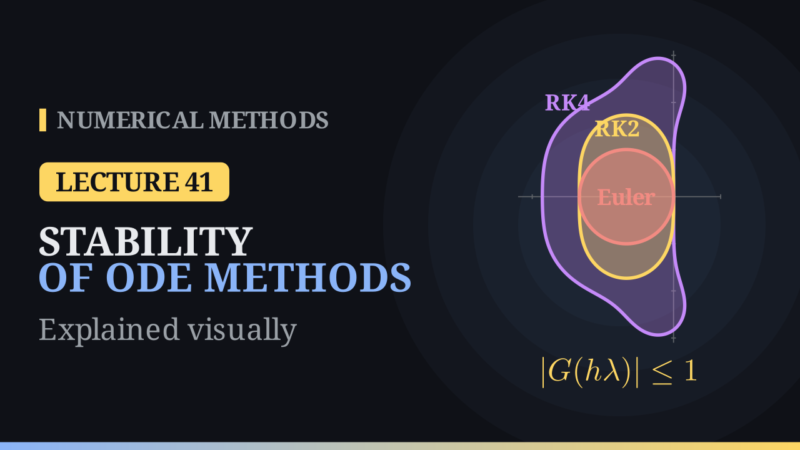

Lecture 41

# Stability of Numerical Methods for ODEs

{ .nm-video }

[Practise this lecture](../practice/lec41_stability.html){ .md-button .md-button--primary }

#### Key results
- **Model problem:** \(y'=\lambda y\) with \(\lambda\in\mathbb C\). A one-step method gives \(y_{n+1}=G(z)\,y_n\) with \(z=h\lambda\), so \(y_n=G(z)^n\,y_0\). The method is **absolutely stable** at \(z\) when \(|G(z)|\le1\); these \(z\) form its **region of absolute stability**.
- **Euler:** \(G(z)=1+z\), the disk \(|1+z|\le1\) around \(-1\). For real \(\lambda<0\): \(h\le2/|\lambda|\). For purely imaginary \(\lambda\) it is unstable for every \(h>0\).
- **RK2** (Heun, midpoint, Ralston): \(G(z)=1+z+\frac{z^2}{2}\); real interval \([-2,0]\). For \(\lambda=-2+2i\): \(h\le0.772\), against \(0.5\) for Euler.
- **RK4:** \(G(z)=1+z+\frac{z^2}{2}+\frac{z^3}{6}+\frac{z^4}{24}\); real interval \([-2.785,0]\), imaginary axis up to \(\pm2\sqrt2\,i\). Explicit methods have polynomial \(G\), so their regions are bounded.
- **Backward Euler:** \(y_{n+1}=y_n+h\,f(t_{n+1},y_{n+1})\), implicit, order 1. \(G(z)=\frac{1}{1-z}\); stable for \(|1-z|\ge1\), which contains the whole left half-plane.
- For \(y'=-20y\): RK4 with \(h=0.15\) (\(z=-3\)) grows by \(1.375\) per step; the largest stable steps are \(0.1\) (Euler) and \(0.139\) (RK4).

## When an accurate method blows up

Take \(y'=-20y\), \(y(0)=1\), whose solution \(e^{-20t}\) dies out almost at once. RK4 with \(h=0.15\) gives

\[
1,\ 1.375,\ 1.89,\ 2.60,\ 3.57,\ \dots
\]

growing by the same factor \(1.375\) at every step, although RK4 is a fourth-order method. With \(h=0.1\) the values fall by a factor \(\frac13\) per step. Between these two steps lies a sharp border that the order of the method does not see. Linear stability analysis finds it.

## The model problem and the growth factor

Every method is studied on the model problem

\[
y'=\lambda y,\qquad y(0)=y_0,\qquad y(t)=y_0\,e^{\lambda t}.
\]

Near a solution, a smooth equation \(y'=f(t,y)\) behaves like its linear part with \(\lambda\approx\frac{\partial f}{\partial y}\); for a system \(\mathbf y'=\mathbf f(t,\mathbf y)\) the role of \(\lambda\) is played by the eigenvalues of the Jacobian \(\partial\mathbf f/\partial\mathbf y\). These can be complex: with \(\lambda=a+ib\), \(e^{\lambda t}=e^{at}(\cos bt+i\sin bt)\) decays when \(a<0\) and oscillates when \(b\neq0\).

A one-step method applied to the model problem multiplies the current value by a fixed number that depends only on \(z=h\lambda\):

\[
y_{n+1}=G(z)\,y_n,\qquad y_n=G(z)^n\,y_0 .
\]

\(G\) is the **growth factor** or **stability function**. The computed values stay bounded exactly when \(|G(z)|\le1\), and the set \(\{z\in\mathbb C:\ |G(z)|\le1\}\) is the method's **region of absolute stability**.

## Euler's method

On \(y'=\lambda y\), \(y_{n+1}=y_n+h\lambda y_n=(1+h\lambda)\,y_n\), so

\[
G(z)=1+z,\qquad |1+z|\le1:
\]

the closed disk of radius \(1\) with centre \(-1\).

**Real \(\lambda<0\).** As \(h\) grows, \(z=h\lambda\) moves left along the real axis and leaves the disk at \(z=-2\): Euler needs \(h\le2/|\lambda|\). For \(\lambda=-20\):

| \(h\) | \(z\) | \(G\) | behaviour |
|:-:|:-:|:-:|:-:|
| 0.025 | \(-0.5\) | \(0.5\) | halves each step |
| 0.05 | \(-1\) | \(0\) | zero after one step |
| 0.075 | \(-1.5\) | \(-0.5\) | flips sign, decays |
| 0.1 | \(-2\) | \(-1\) | flips between \(1\) and \(-1\) |
| 0.12 | \(-2.4\) | \(-1.4\) | flips sign, grows |

**Complex \(\lambda\).** For \(\lambda=-2+2i\), \(z=h\lambda\) walks along a ray, and

\[
|1+z|^2=(1-2h)^2+4h^2=1-4h+8h^2\le1\iff h\le\tfrac12 .
\]

At \(h=\frac12\), \(z=-1+i\) lies on the circle.

**Pure oscillation.** For \(\lambda=3i\), \(|1+3ih|=\sqrt{1+9h^2}>1\) for every \(h>0\): Euler is unstable on the imaginary axis whatever the step. With \(h=0.1\) the modulus grows by a factor \(1.09^{5}\approx1.54\) up to \(t=1\), the outward spiral of the oscillator in Lecture 37.

## Runge–Kutta methods

For Heun's method, \(K_1=h\lambda\,y_n\), \(K_2=h\lambda\,(y_n+K_1)\) and \(y_{n+1}=y_n+\frac12(K_1+K_2)\), so

\[
G(z)=1+z+\frac{z^2}{2},
\]

the first three terms of \(e^z\). Every two-stage method of order two (Heun, midpoint, Ralston) has this \(G\). Its real interval is again \([-2,0]\), but the region is wider off the axis: for \(\lambda=-2+2i\), \(|G(h\lambda)|^2=(1-2h)^2(1+4h^2)\), which equals \(1\) at \(h\approx0.772\). On the imaginary axis \(|G(iy)|^2=1+\frac{y^4}{4}\), so for \(\lambda=3i\), \(h=0.1\) the modulus grows by only \(1.01\) in ten steps.

For RK4 the same computation gives

\[
G(z)=1+z+\frac{z^2}{2}+\frac{z^3}{6}+\frac{z^4}{24},
\]

the first five terms of \(e^z\). The region reaches \(-2.785\) on the real axis and contains the imaginary axis up to \(\pm2\sqrt2\,i\approx\pm2.83\,i\).

This explains the opening example: for \(y'=-20y\), \(h=0.15\) gives \(z=-3\), outside the RK4 interval, and \(G(-3)=1.375\); \(h=0.1\) gives \(z=-2\) and \(G(-2)=\frac13\). The largest stable steps are

\[
h_{\max}^{\text{Euler}}=\frac{2}{20}=0.1,\qquad h_{\max}^{\text{RK4}}=\frac{2.785}{20}\approx0.139 .
\]

The exact factor over one step is \(e^z\), with \(|e^z|\le1\) exactly when \(\mathrm{Re}\,z\le0\). An explicit method copies \(e^z\) near \(z=0\), which is why a high order means accuracy for small \(z\); but its \(G\) is a polynomial, \(|G(z)|\to\infty\) as \(|z|\to\infty\), and so **every explicit Runge–Kutta method has a bounded stability region**. A \(\lambda\) with a large negative real part forces a tiny step, however smooth the solution.

## The backward Euler method

Taking the slope at the new point instead of the old one gives

\[
\boxed{y_{n+1}=y_n+h\,f(t_{n+1},\,y_{n+1}).}
\]

The unknown \(y_{n+1}\) appears on both sides, so the method is **implicit**: every step solves \(g(Y)=Y-y_n-h\,f(t_{n+1},Y)=0\). Fixed-point iteration \(Y^{(m+1)}=y_n+h\,f(t_{n+1},Y^{(m)})\) converges when \(hL<1\); Newton's method

\[
Y^{(m+1)}=Y^{(m)}-\frac{Y^{(m)}-y_n-h\,f(t_{n+1},Y^{(m)})}{1-h\,f_y(t_{n+1},Y^{(m)})}
\]

is more robust, started from \(Y^{(0)}=y_n\). For \(y'=-y^3\), \(y(0)=1\), \(h=1\), the equation is \(Y+Y^3-1=0\) and Newton gives \(1\to0.75\to0.6860\to0.6823\). Like forward Euler, the method has order \(1\).

**Example.** For \(y'=t+y\), \(y(0)=1\), \(h=0.1\), the equation is linear in \(y_{n+1}\):

\[
y_{n+1}=\frac{y_n+h\,t_{n+1}}{1-h}.
\]

| \(t_n\) | forward Euler | backward Euler | exact |
|:-:|:-:|:-:|:-:|
| 0.0 | 1.00000 | 1.00000 | 1.00000 |
| 0.1 | 1.10000 | 1.12222 | 1.11034 |
| 0.2 | 1.22000 | 1.26914 | 1.24281 |

Forward Euler lies below this growing, convex solution and backward Euler above it, both with \(O(h)\) error.

**Stability.** On \(y'=\lambda y\), \(y_{n+1}=y_n+z\,y_{n+1}\), so \((1-z)\,y_{n+1}=y_n\) and

\[
G(z)=\frac{1}{1-z},\qquad |G(z)|\le1\iff|1-z|\ge1 .
\]

The region is everything outside the open disk of radius \(1\) around \(+1\); it contains the whole left half-plane. For \(y'=-20y\) with \(h=0.15\), \(G=\frac{1}{1+3}=\frac14\): the values fall to \(\frac14,\frac1{16},\dots\) where RK4 grew. For \(\lambda=3i\), \(h=0.1\), \(|G|^{10}\approx0.65\): backward Euler damps the oscillation, so stability is not the same as accuracy.

## One step, four methods

For \(y'=-y\), \(y(0)=1\), \(h=\frac12\) (\(z=-\frac12\), inside every region), \(e^{-1/2}=0.60653\):

| method | \(G(-\tfrac12)\) | error |
|:-:|:-:|:-:|
| Euler | 0.5 | 0.107 |
| Heun (RK2) | 0.625 | 0.0185 |
| RK4 | 0.60677 | \(2.4\times10^{-4}\) |
| backward Euler | 0.66667 | 0.0601 |

Inside the stability region, the order decides the accuracy.

## Choosing a stable step

1. Find \(\lambda\): \(f_y\) along the solution, or the eigenvalues of the Jacobian for a system.
2. Find the largest \(h\) with \(|G(h\lambda)|\le1\). For real \(\lambda\) this is the end of the real interval divided by \(|\lambda|\); for complex \(\lambda\), solve \(|G(h\lambda)|=1\), for example by bisection (Lecture 1). For RK2 and \(\lambda=-2+2i\) this gives \(h\approx0.772\).
3. Use the smaller of this step and the step that the accuracy needs.

## Comparison

| method | \(G(z)\) | real interval | region | type |
|:-:|:-:|:-:|:-:|:-:|
| Euler | \(1+z\) | \([-2,0]\) | disk | explicit |
| RK2 | \(1+z+\frac{z^2}{2}\) | \([-2,0]\) | bounded | explicit |
| RK4 | \(1+z+\dots+\frac{z^4}{24}\) | \([-2.785,0]\) | bounded | explicit |
| backward Euler | \(\frac{1}{1-z}\) | \((-\infty,0]\) | unbounded | implicit |

Explicit methods are cheap per step but have bounded regions; backward Euler solves an equation at every step but never blows up on a decaying problem. Next lecture: A-stability and stiff problems, such as \(y'=-1000\,(y-\cos t)\), where Euler needs \(h\le0.002\) although the solution stays close to \(\cos t\).

[Practise this lecture](../practice/lec41_stability.html){ .md-button .md-button--primary }
[← Previous: Runge–Kutta Methods: RK4](lec40-rk4.md){ .md-button }
[Next: A-Stability and Stiff Problems →](lec42-stiff.md){ .md-button }

